# Module 1: Create a canvas app with Copilot in Power Apps

## Lab Scenario

In this exercise, you'll take on the role of a software developer tasked with creating a user-friendly canvas app using Copilot in Power Apps. Your objective is to build an app that helps a real estate team manage property showings. Start by describing your data to Copilot so that it generates a Dataverse table, then use natural language prompts to add columns, add a status choice column, and add sample rows. Finally, open the generated app, adjust what the gallery and form display, test the app by adding a new showing, and save it. This lab shows how Copilot in Power Apps can streamline app development and improve productivity.

## Lab objectives

In this lab, you will complete the following tasks:

- Task 1: Create a Power Platform environment
- Task 2: Create an app with Copilot
- Task 3: Edit and test the app

### Task 1: Create a Power Platform environment

In this task, you'll create a new Power Platform environment with a Dataverse data store to support app development. You'll set the essential details and review the environment settings.

1. Open a new browser tab and navigate to the Power Platform admin center by copying and pasting the following link:

   ```
   https://aka.ms/ppac
   ```

1. On the **Sign in** page, enter the following email/username **(1)**, and then select **Next (2)**.

   - **Email/Username:** <inject key="AzureAdUserEmail" enableCopy="true"/>

     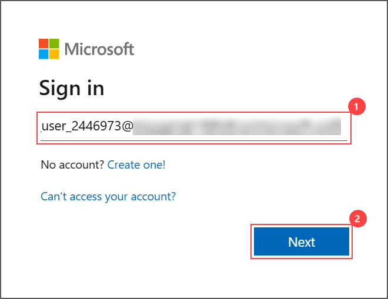

1. On the **Enter Temporary Access Pass** page, enter the following Temporary Access Pass **(1)**, and then select **Sign in (2)**.

   - **Temporary Access Pass:** <inject key="AzureAdUserPassword" enableCopy="true"/>

     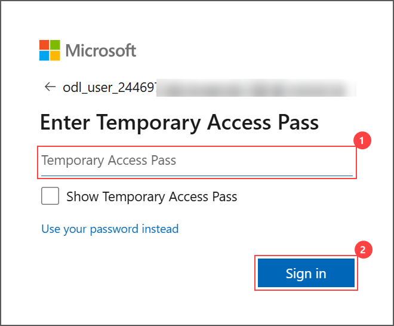

   > **Note:** Your lab account signs in with a Temporary Access Pass instead of a password, so no multifactor authentication setup is needed. If you see a **Stay signed in?** prompt, select **No**.

1. In the left navigation, select **Manage (1)**, select **Environments (2)**, and then select **+ New (3)** on the toolbar.

   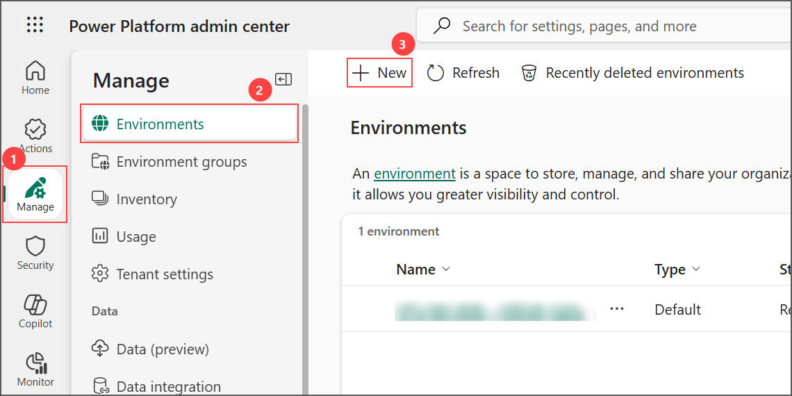

1. In the **New environment** pane, enter the following details:

   - **Type:** Leave **Sandbox (1)** selected
   - **Macro Region Geography:** Select **North America (2)**
   - **Name:** Enter **Copilot (3)**

     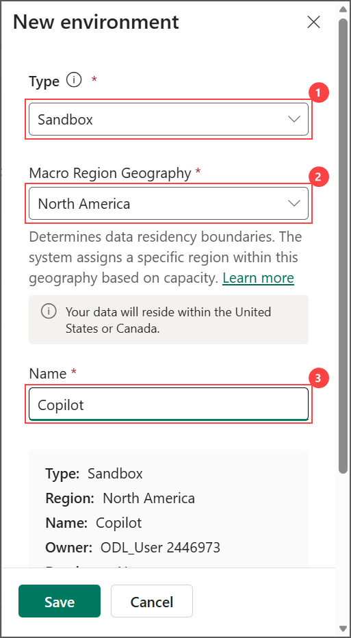

1. Scroll down in the pane, expand **Change default settings (1)**, set **Add a Dataverse data store?** to **Yes (2)**, keep all other settings unchanged, and then select **Next (3)**.

   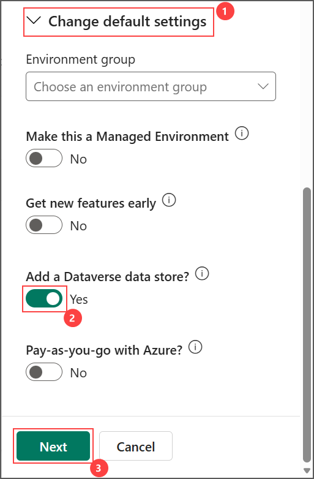

   > **Note:** The **Save** button changes to **Next** after you turn on the Dataverse data store.

1. In the **Add Dataverse** pane, keep **English (United States)** as the **Language** and **USD ($)** as the **Currency**. Under **Security group**, select **+ Select**.

   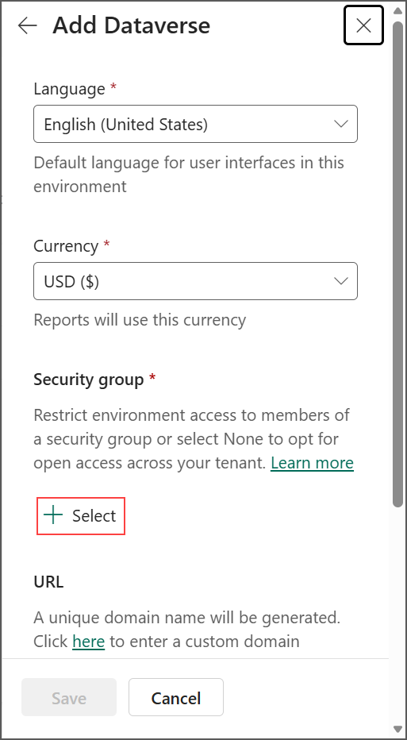

1. In the **Edit security group** pane, under **Open access**, select **None (1)**, and then select **Done (2)**.

   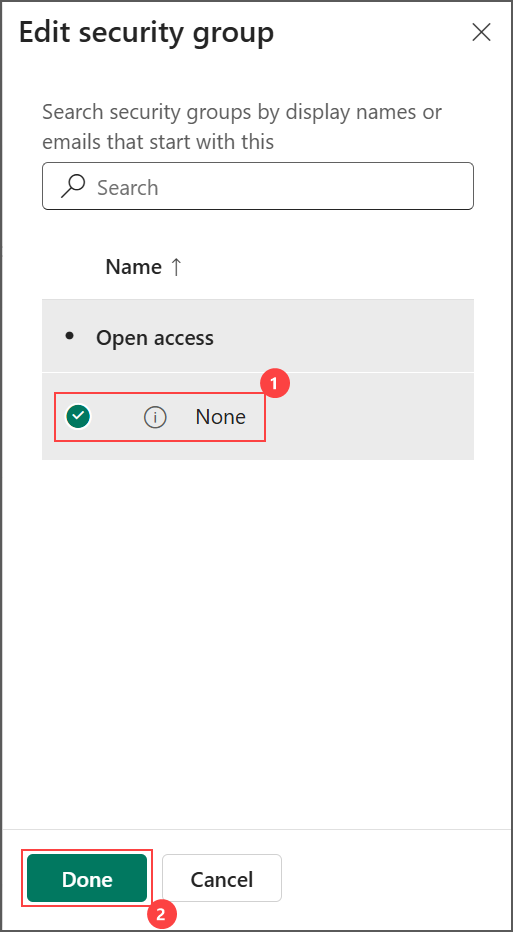

1. Back in the **Add Dataverse** pane, confirm that the security group shows **None**, and then select **Save**.

   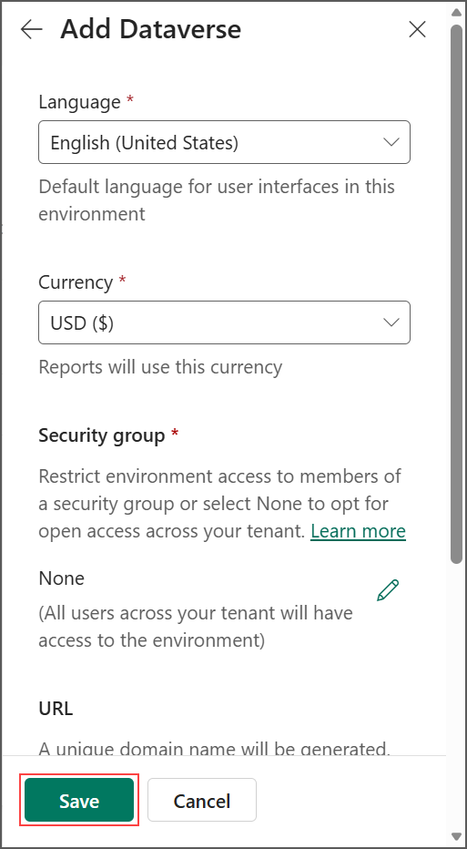

   > **Note:** If you see the message **A self-service signup plan is required to successfully complete this request**, the Power Apps license for your lab account is still being applied. Wait a few minutes, and then select **Save** again. If the message persists, contact CloudLabs support.

1. In the list of environments, your **Copilot** environment shows the state **Preparing**.

   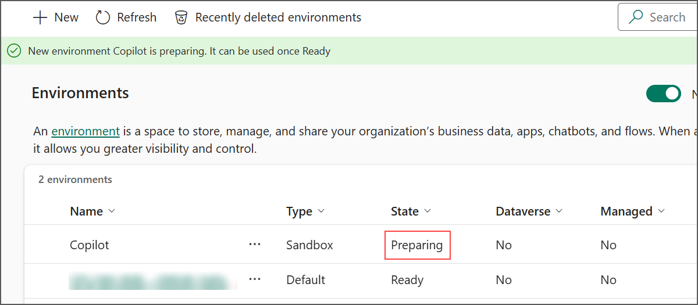

   > **Note:** The environment takes a few minutes to provision. Select **Refresh** on the toolbar to update the list.

1. When the state of the **Copilot** environment changes to **Ready**, select the **More actions (...) (1)** icon next to the environment name, and then select **Settings (2)**.

   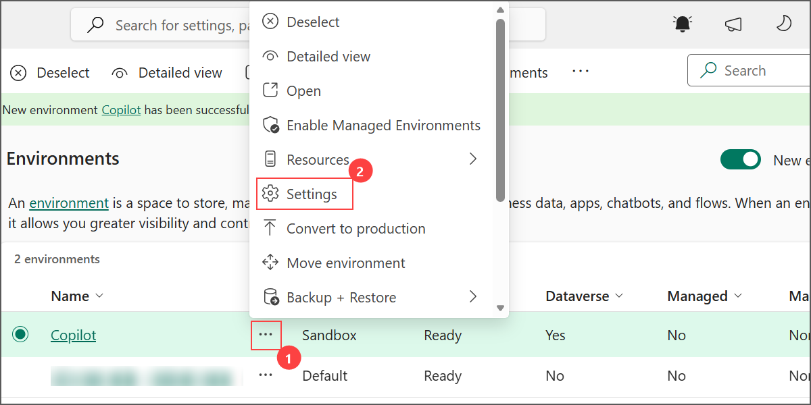

1. The **Settings** page for the **Copilot** environment opens.

   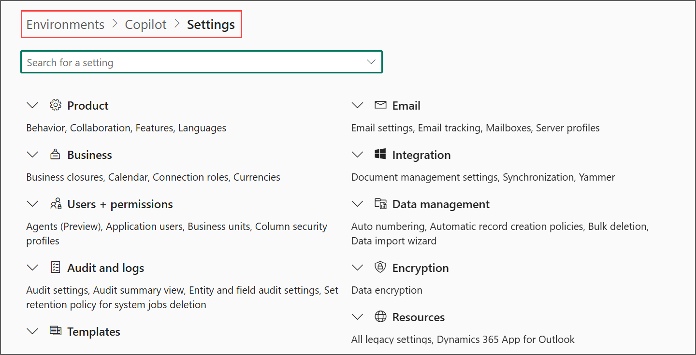

   > **Note:** Browse through the sections under **Settings** that interest you, but don't make any changes.

### Task 2: Create an app with Copilot

In this task, you'll use Copilot in Power Apps to describe your data, generate a Dataverse table, refine the table with natural language prompts, and then create a canvas app from it.

1. Open a new browser tab and navigate to [https://make.powerapps.com](https://make.powerapps.com) to open Power Apps.

1. If the **Welcome to Power Apps** dialog appears, keep **United States (1)** as the country or region, and then select **Get started (2)**.

   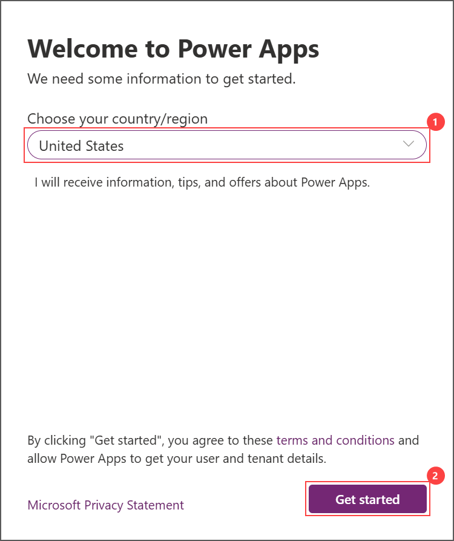

   > **Note:** This dialog appears only the first time you open Power Apps.

1. Power Apps opens in the default environment. In the upper-right corner, select **Environment (1)**, and then in the **Select environment** pane, select **Copilot (2)**.

   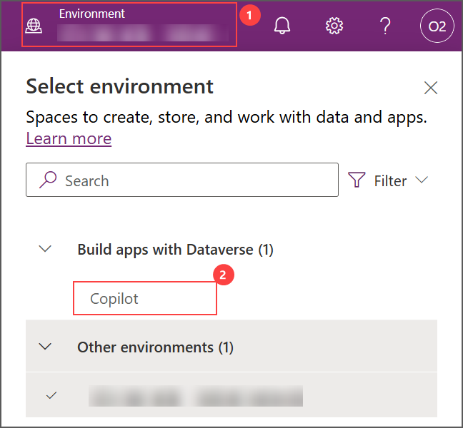

1. From the left navigation menu, select **Apps (1)**. On the toolbar, open the **+ New app (2)** drop-down, and then select **Start with data (3)**.

   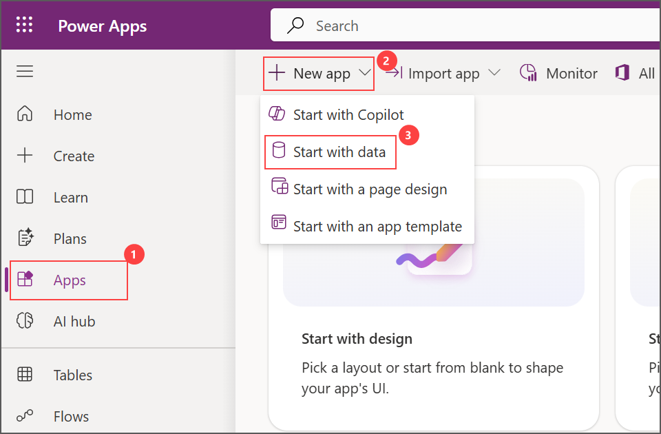

1. On the **Start with data** page, under **Describe the data for your app**, enter the following prompt **(1)**, and then select the **Send (2)** button.

   ```
   build an app to manage real estate showings
   ```

   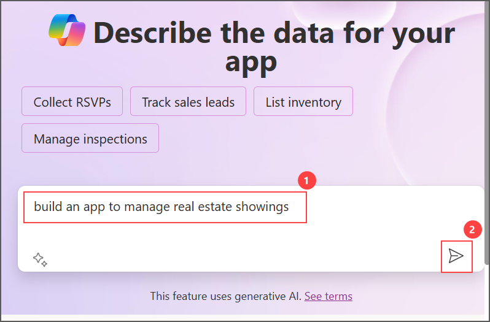

1. Copilot generates four related tables: **Showing**, **Client**, **Agent**, and **Property**. This lab needs a single table that holds all the showing details. In the **Copilot** pane, below the list of tables, select the **Table options** icon.

   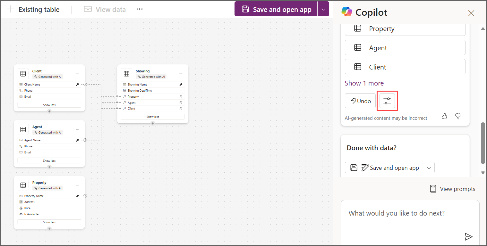

1. Under **Table options**, select **One table (1)**, and then select **Apply (2)**.

   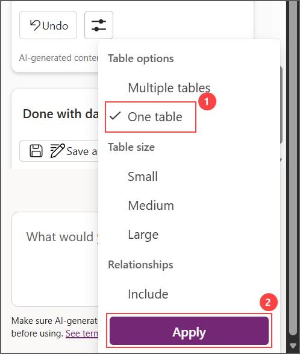

1. Copilot replaces the four tables with a single **RealEstateShowing** table. Review the columns that Copilot created.

   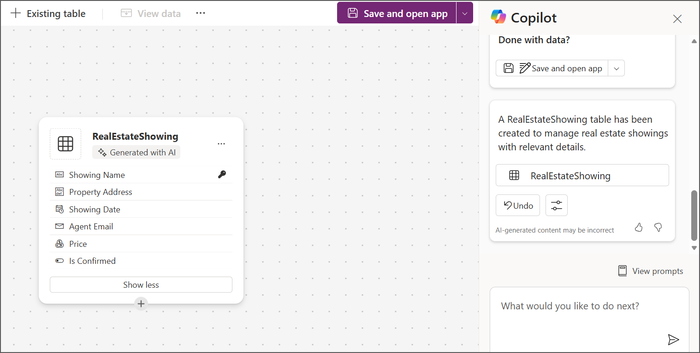

   > **Note:** The columns and data that Copilot generates might differ slightly from the screenshots in this lab.

1. In the text box at the bottom of the **Copilot** pane, enter the following prompt, and then select the **Send** button.

   ```
   add a column to the RealEstateShowing table to track client full name
   ```

   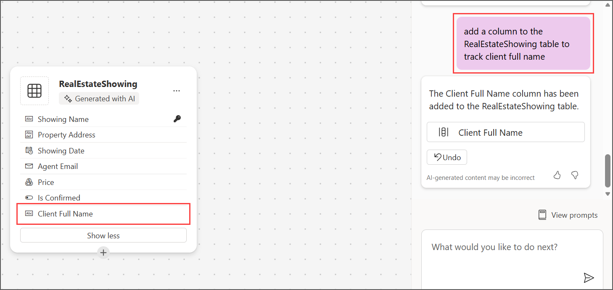

   > **Note:** Always include the table name in your prompts. If you leave it out, Copilot replies **Please reenter the query and ensure the relevant table names are also specified.**

1. Enter the following prompt, and then select the **Send** button.

   ```
   add a column to the RealEstateShowing table to track client email
   ```

   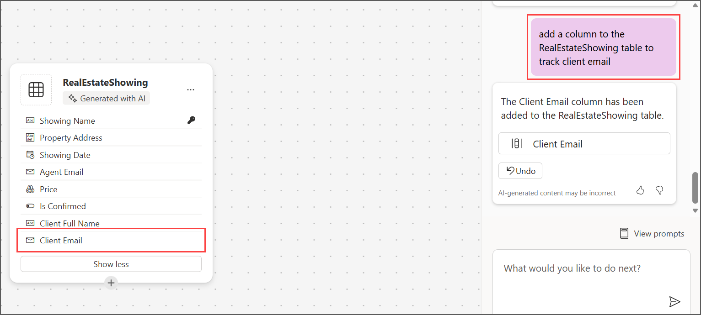

1. The table doesn't have a status column yet. Enter the following prompt to add a choice column with a **Completed** option, and then select the **Send** button.

   ```
   add a Status choice column to the RealEstateShowing table with the options Scheduled, Completed, and Canceled
   ```

   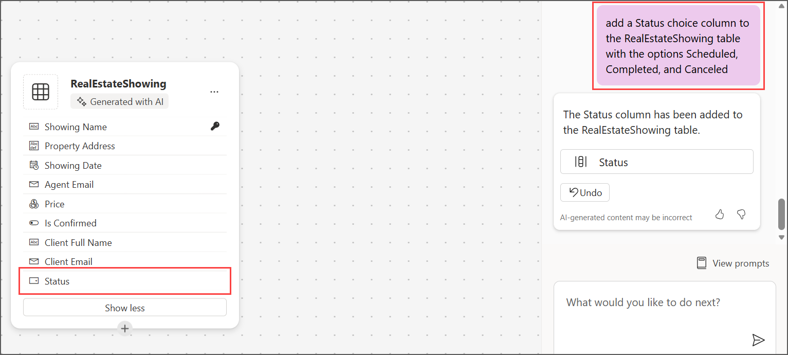

1. Enter the following prompt to add sample data, and then select the **Send** button.

   ```
   add 5 more rows of data to the RealEstateShowing table
   ```

   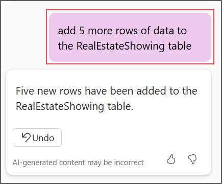

1. Enter the following prompt, and then select the **Send** button.

   ```
   add a column to the RealEstateShowing table to track client address
   ```

   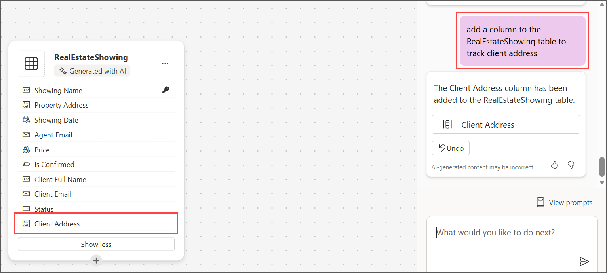

1. Enter the following prompt, and then select the **Send** button.

   ```
   add a column to the RealEstateShowing table to track an ID for each showing
   ```

   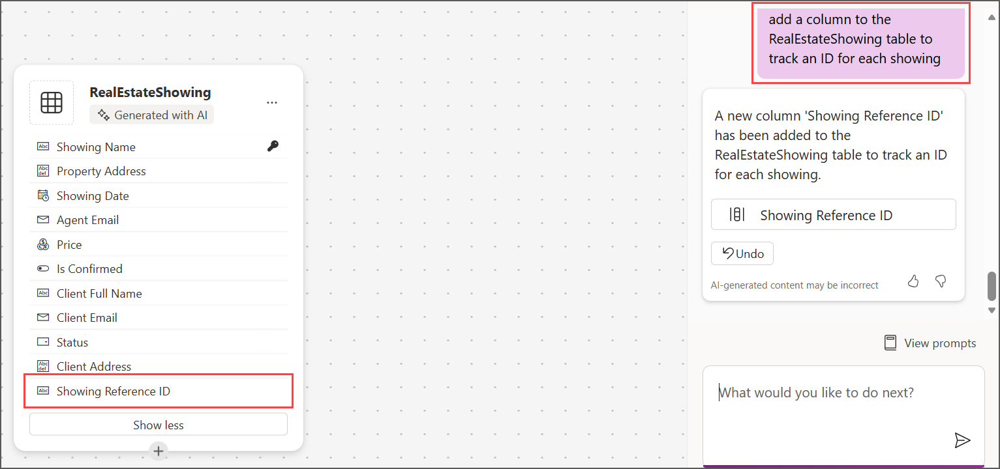

   > **Note:** Copilot chooses the name of the ID column, for example **Showing Reference ID**. Note the name, because you'll use this column in Task 3.

1. On the **RealEstateShowing** table card, select the **More options (...) (1)** icon, and then select **View data (2)**.

   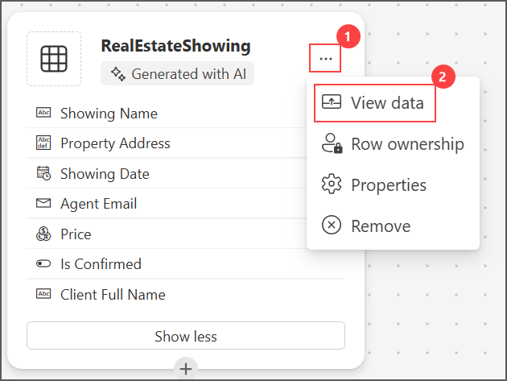

1. Review the sample rows in the data grid at the bottom of the page. You can scroll to the right to see every column. From here, you can also rename, delete, update, and add columns.

   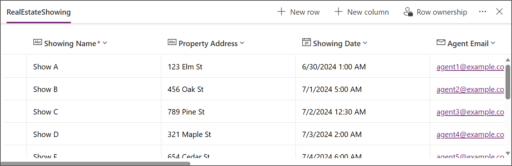

1. On the toolbar, select **Save and open app**.

   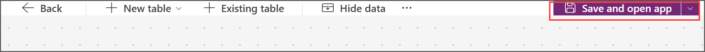

1. In the **Done working?** dialog, select **Save and open app**.

   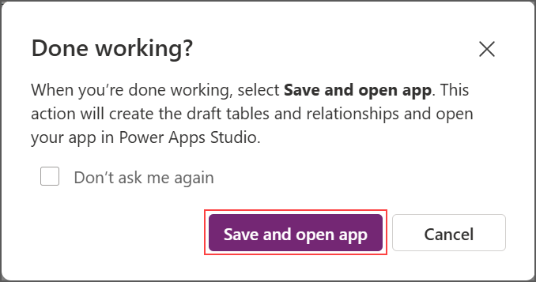

   > **Note:** Power Apps creates the table in Dataverse and builds the app. This can take a minute.

1. The app opens in Power Apps Studio in **Editing** mode.

   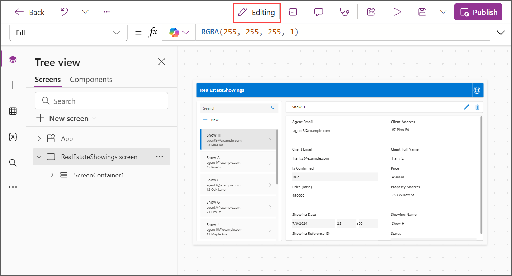

   > **Note:** If the **Welcome to Power Apps Studio** dialog appears, select **Skip**.

### Task 3: Edit and test the app

In this task, you'll change what the gallery and form display, test the app by adding a new showing, and then save the app.

1. In the **Tree view** pane, expand **RealEstateShowings screen** > **ScreenContainer1** > **BodyContainer1** > **SidebarContainer1** > **RecordsGallery1 (1)**, and then select **Title1 (2)**. Make sure that **Text** is selected in the property list, and then replace the formula in the formula bar with **ThisItem.'Client Address' (3)**.

   ```
   ThisItem.'Client Address'
   ```

   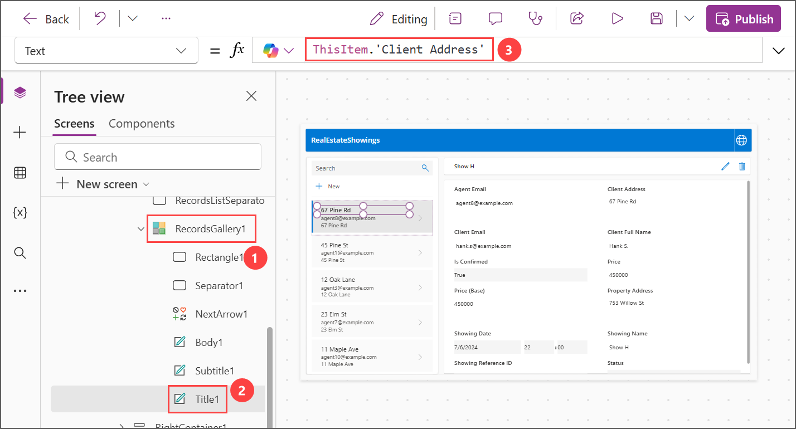

   > **Hint:** You can also select the title of the first record in the gallery on the canvas to select **Title1**.

1. In **RecordsGallery1**, select **Subtitle1 (1)**, and then set its **Text** property to **ThisItem.'Client Email' (2)**.

   ```
   ThisItem.'Client Email'
   ```

   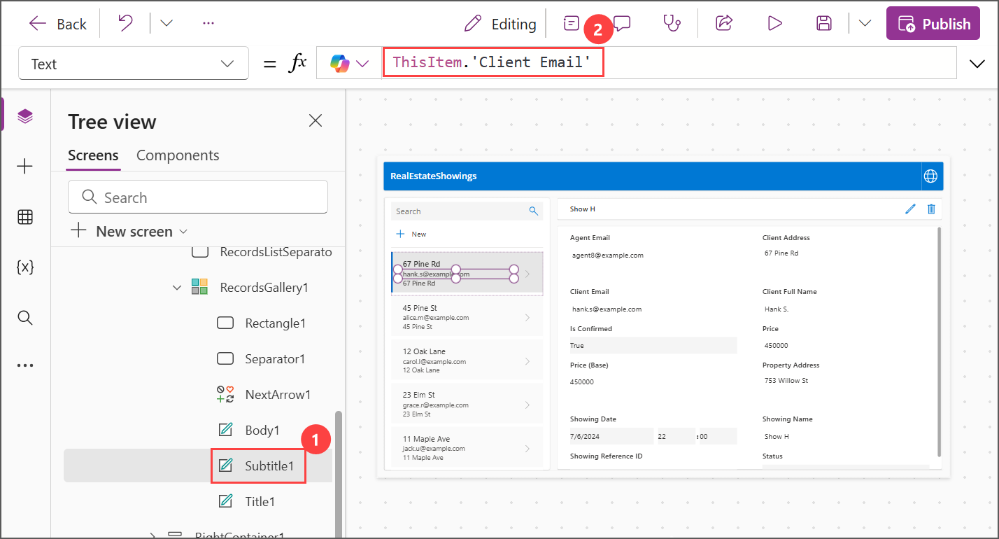

1. Select **Body1 (1)**, and then set its **Text** property to show the status **(2)**:

   - In the formula bar, delete the existing formula and type **Text(ThisItem.Stat**.
   - From the suggestion list, select the first entry, **'Status (crxxx_status)'**.
   - Type **)** to close the formula.

   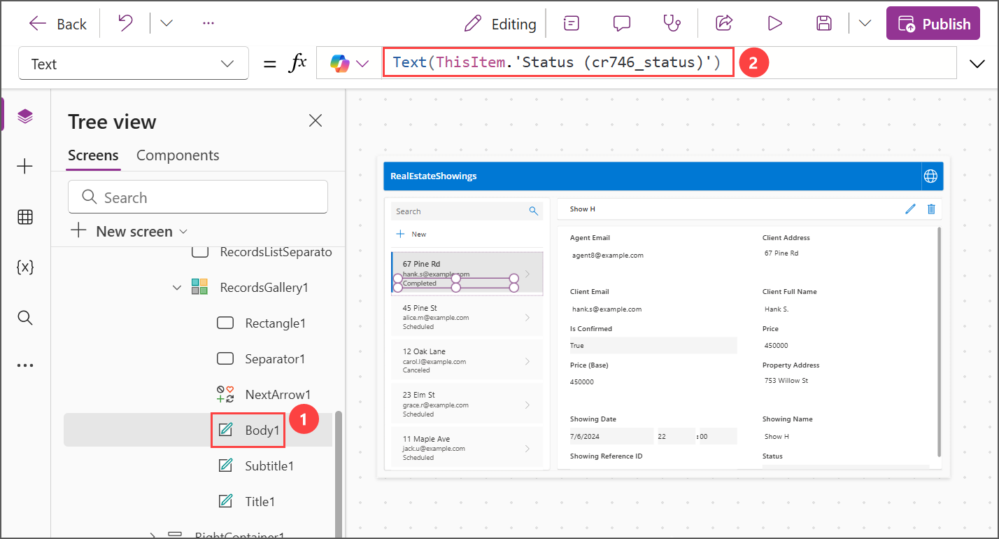

   > **Note:** Every Dataverse table already has a system column named **Status**, so the column you added appears in the list with its logical name, for example **'Status (cr746_status)'**. The prefix (**cr746** in this example) is different in your environment. Because Status is a choice column, the **Text** function converts the selected option into text that the label can show.

1. A record in the gallery now shows the client address, the client email, and the status.

   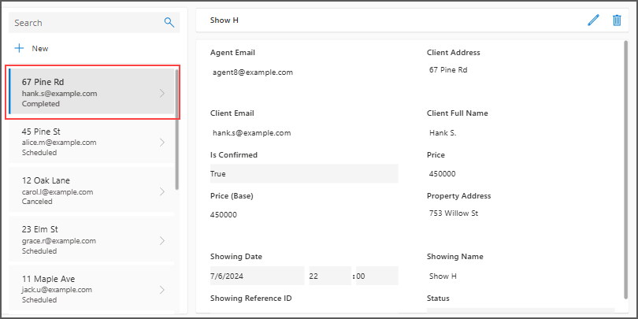

1. In the **Tree view** pane, select **Form1 (1)**. You can find it under **RightContainer1** > **MainContainer1**, or type **Form1** in the **Search** box at the top of the tree. The **Properties** pane shows **Form1 (2)**.

   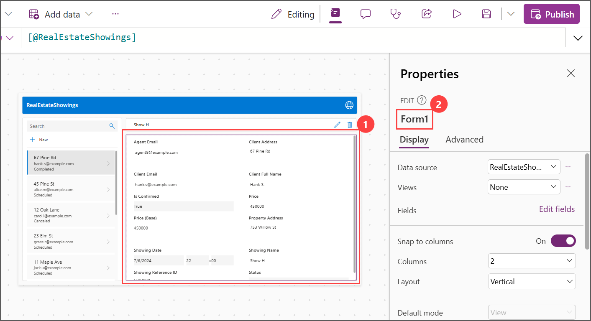

   > **Note:** If the **Properties** pane isn't visible, select the **Properties** icon on the toolbar.

1. In the **Properties** pane, select **Edit fields (1)**. In the **Fields** pane, expand the ID column that Copilot created, for example **Showing Reference ID (2)**. Open the **Control type (3)** drop-down, and then select **View text (4)**.

   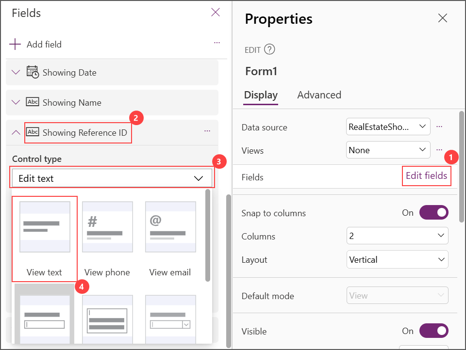

   > **Note:** The ID field is now read-only in the form. Close the **Fields** pane when you're done.

1. To test the app, select the **Play** icon in the upper-right part of the toolbar.

   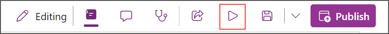

1. In the app preview, select **+ New** above the list of showings.

   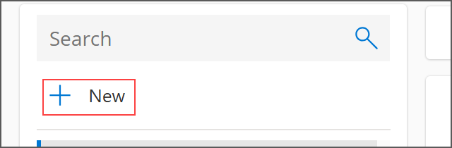

1. Fill in the form with the following information. Though you could change the form to fill in some fields automatically, in this lab you'll enter them manually to observe how the app works.

   - **Agent Email:** agent11@example.com
   - **Client Address:** 210 Pine Road, Portland, OR 97204
   - **Client Email:** alex.morgan@example.com
   - **Client Full Name:** Alex Morgan
   - **Is Confirmed:** True
   - **Price:** 525000
   - **Property Address:** 1450 Lakeview Drive, Portland, OR 97205
   - **Showing Date:** Any future date and time
   - **Showing Name:** Show K
   - **Status:** Scheduled

     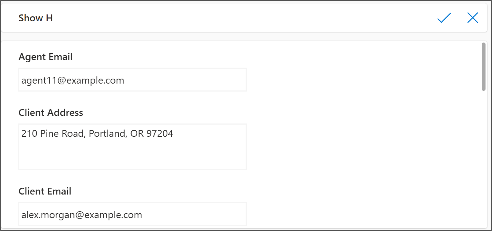

   > **Note:** The ID field is read-only, so you don't enter a value for it.

1. Select the **check mark** in the upper-right corner of the form to save the record.

   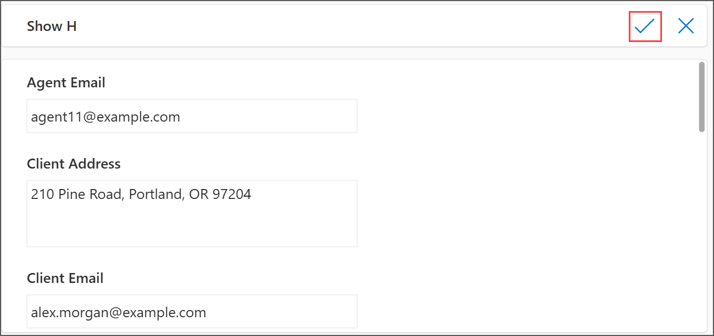

1. The new showing appears in the list of showings and shows the client address, the client email, and the **Scheduled** status.

   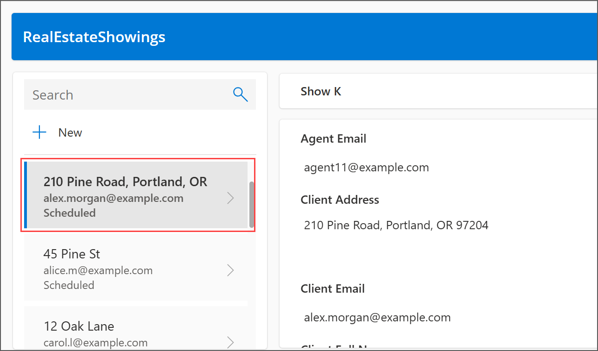

1. Select the **X** in the upper-right corner to close the app preview.

   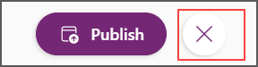

1. If the **Did you know?** dialog appears, select **Ok**.

   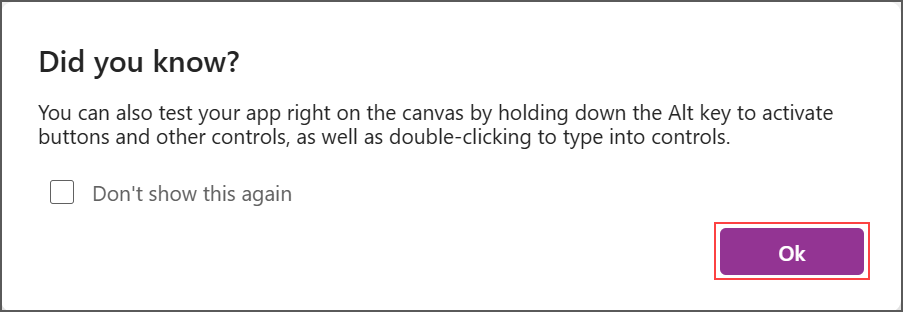

1. On the toolbar, select the **Save** icon to save the app.

   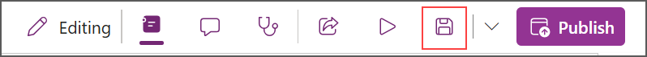

1. In the **Save as** dialog, enter **Real Estate Showings (1)** as the name, and then select **Save (2)**.

   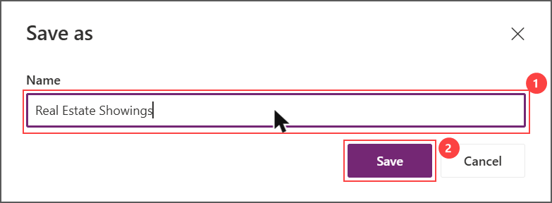

1. When the app is saved, select **Back (1)** in the upper-left corner, and then in the **Leave the app?** dialog, select **Leave (2)**.

   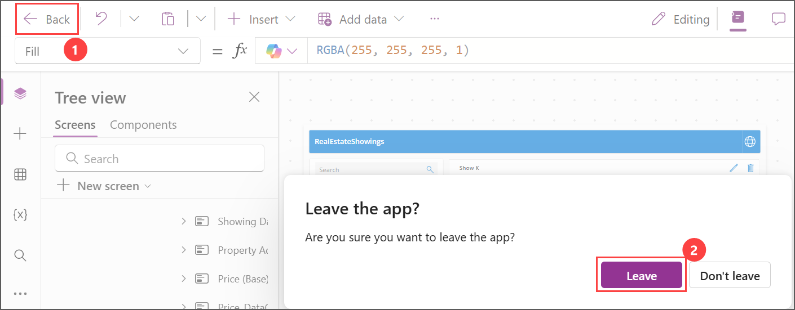

1. If the **Start with data** page opens, select **Cancel**. On the **Apps** page, confirm that **Real Estate Showings** appears under **My apps**.

   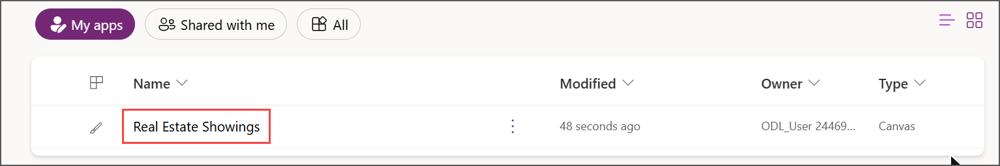

## Summary

In this lab, you have accomplished the following:

- Created a Power Platform environment with a Dataverse data store to support app development.
- Used Copilot to generate a Dataverse table, refine its columns and data with natural language prompts, and build a canvas app.
- Changed what the app's gallery and form display, tested the app by adding a record, and saved the app.

### Congratulations! You have successfully completed this lab. Click **Next** to continue to the next lab.
