# Module 2: Create an approval flow with Copilot in Power Automate

## Lab Scenario

In this exercise, you'll automate the approval of real estate showing requests. When an agent adds a showing to the **RealEstateShowings** table that you built in Module 1, a flow sends an approval request, records the decision in the **Is Confirmed** column, and emails the client the result. You'll describe the flow to Copilot in Power Automate, review and complete the actions it generates, add email notifications, and then test the flow end to end by adding a showing in the Real Estate Showings app and approving the request in Outlook.

## Lab objectives

In this lab, you will complete the following tasks:

- Task 1: Create an approval flow with Copilot
- Task 2: Add email notifications and test the flow

### Task 1: Create an approval flow with Copilot

In this task, you'll describe an approval flow to Copilot, and then complete the trigger, the approval, the condition, and the actions that update the row.

1. Open a new browser tab and navigate to Power Automate by copying and pasting the following link:

   ```
   https://make.powerautomate.com
   ```

   > **Note:** If you're asked to sign in, use the following credentials. If a **Pick an account** page appears, select your lab account.
   >
   > - **Email/Username:** <inject key="AzureAdUserEmail" enableCopy="true"/>
   > - **Temporary Access Pass:** <inject key="AzureAdUserPassword" enableCopy="true"/>

1. Power Automate opens in the default environment. In the upper-right corner, select **Environments (1)**, and then under **Build flows**, select **Copilot (2)**, the environment that you created in Module 1.

   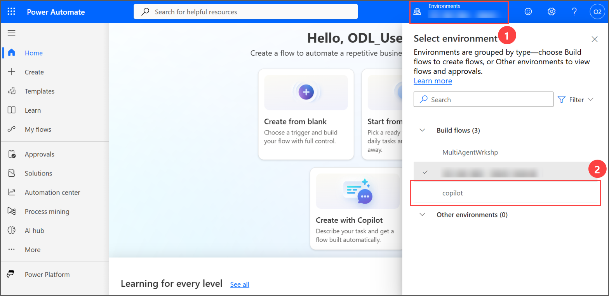

1. On the Home page, select **Create with Copilot**.

   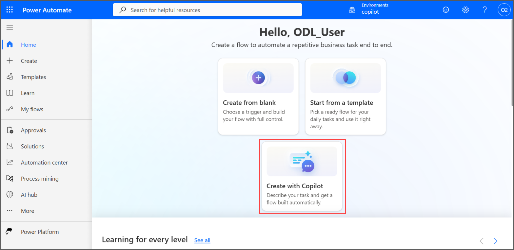

1. On the **Describe it to design it** page, enter the following prompt **(1)**, and then select the **Send** arrow **(2)**.

   ```
   When a row is added to the RealEstateShowing table in Dataverse, start and wait for an approval. If approved, update the same row and set Is Confirmed to Yes. If rejected, update the same row and set Is Confirmed to No.
   ```

   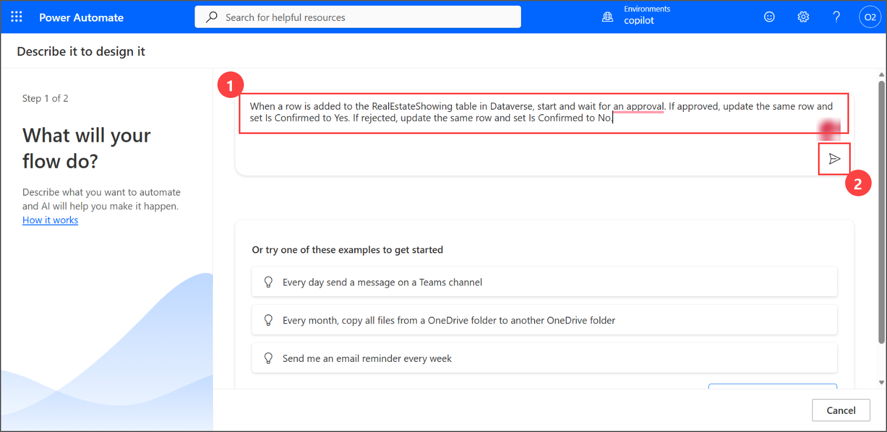

1. Copilot shows a suggested flow with a Dataverse trigger, a **Start and wait for an approval** action, and a **Condition** with an **Upsert a row** action in each branch. Review the outline, and then select **Keep it and continue**.

   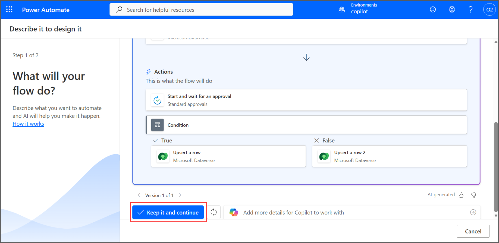

   > **Note:** Copilot might suggest a slightly different flow. If the outline doesn't match, select the **Regenerate** icon next to **Keep it and continue**, or rephrase the prompt.

1. On the **Make sure everything's ready** page, confirm that **Microsoft Dataverse** and **Standard approvals** show a green check mark **(1)**, and then select **Create flow (2)**.

   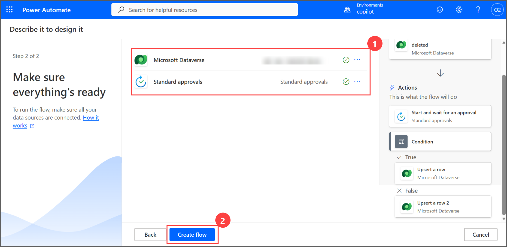

1. The designer opens with your flow on the canvas and the **Copilot** pane on the right. The **Start and wait for an approval** action shows **Invalid parameters**, which you'll fix in the next steps.

   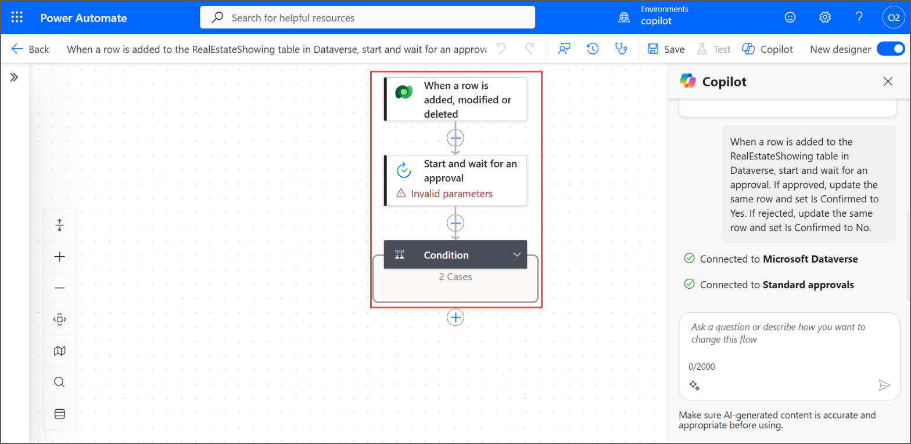

   > **Note:** If tips such as **Expand or collapse all actions** or **Drafts and Versioning now available** appear, select **Got it** or **Maybe later** to close them.

1. Select the **When a row is added, modified or deleted** trigger and set the following parameters:

   - **Change type:** Select **Added**.
   - **Table name:** Copilot entered **RealEstateShowing**, which Dataverse doesn't recognize. Select the **X** to clear it, enter **RealEstate** in the box, and then select **RealEstateShowings**.
   - **Scope:** Copilot might enter **4**. Select the **X** to clear it, and then select **Organization**.

     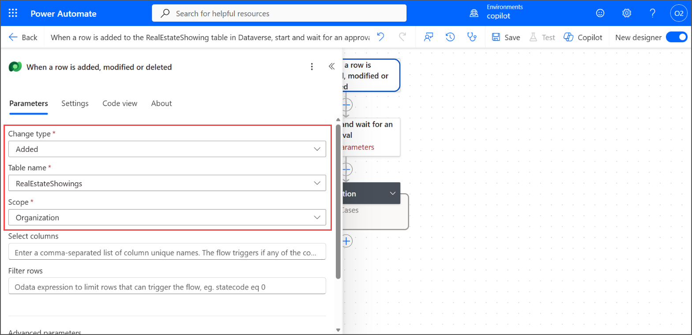

   > **Note:** The trigger might show the warning **Failed to retrieve dynamic outputs ... Could not find table with name 'RealEstateShowing'** until you select the table from the list.

1. Select the **Start and wait for an approval** action. Open the **Approval type** list **(1)**, and then select **Approve/Reject - First to respond (2)**. More parameters appear.

   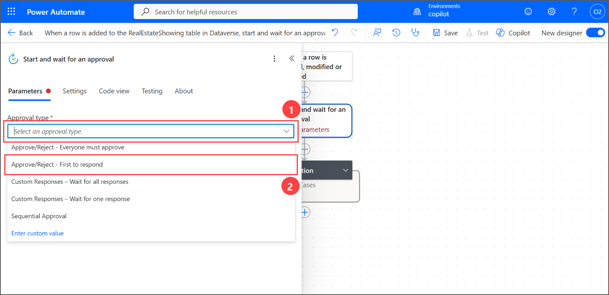

1. In **Title**, enter **New Request for Real Estate Showing**. In **Assigned to**, enter **odl_user**, and then select your lab account from the list.

   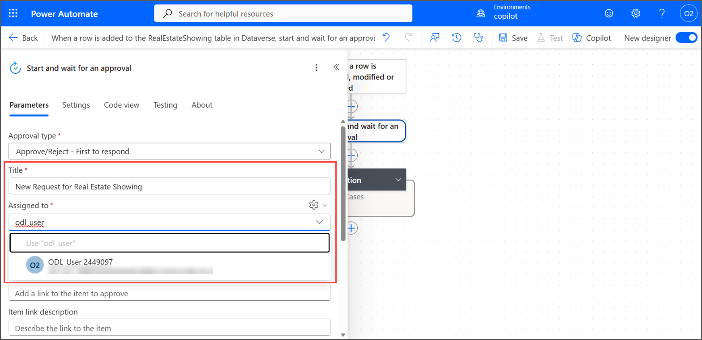

   > **Note:** You can also ask Copilot to set parameters, but in testing it added a note to the action instead of filling in the **Title**, so enter the value yourself.

1. In **Details**, enter the following text. Press **Shift+Enter** to start each new line.

   ```text
   A new request for a real estate showing has been created. Please review the details below and approve or reject the request:
   Property:
   Client:
   Client Email:
   ```

1. Place the cursor after **Property:** and select the **Insert data from previous step** (lightning) icon **(1)**. In the search box, enter **Property (2)**, and then select **Property Address (3)**.

   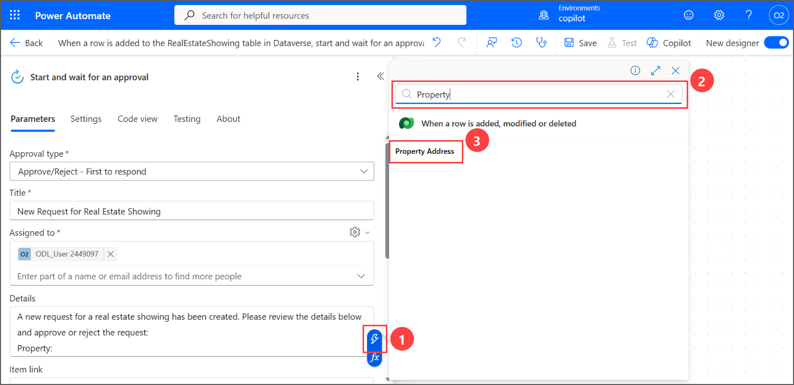

1. In the same way, add **Client Full Name** after **Client:** and **Client Email** after **Client Email:**. The **Details** parameter should resemble the following image.

   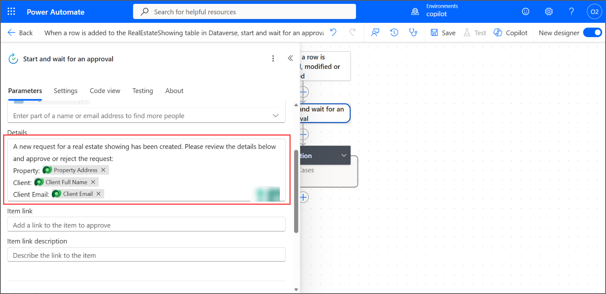

   > **Hint:** You can also type **/** in a parameter to insert dynamic content.

1. Select the **Condition** action. Copilot already set the condition to the approval **Outcome** **is equal to** **Approve**. Confirm the first row matches the image.

   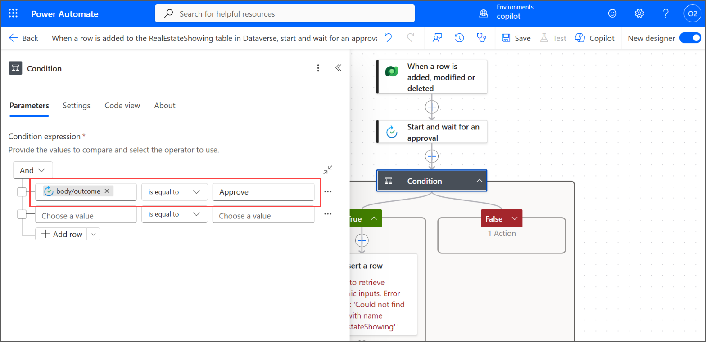

   > **Note:** If Copilot also added an empty second row, you can leave it. The designer ignores empty rows when you save.

1. On the canvas, under **True**, select the **Upsert a row** action. Like the trigger, it shows an error because the table name is wrong.

   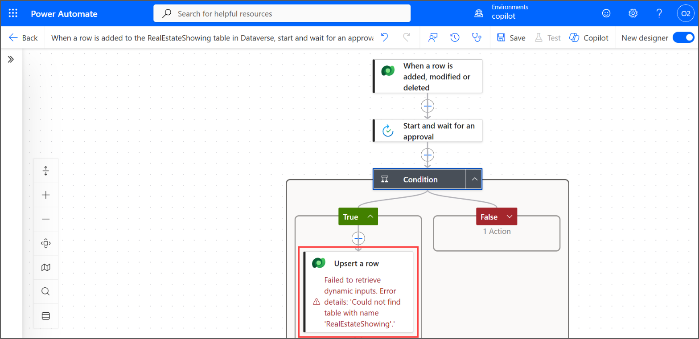

1. In **Table name**, select the **X** to clear the value, enter **RealEstate**, and then select **RealEstateShowings (1)**. If **Row ID (2)** already shows a **body/PrimaryKeyValue** token, select its **X** to remove it. Select the **Row ID** box, select the lightning icon, enter **RealEstateShowing** in the search box, and then select **RealEstateShowing (3)**, the unique identifier of the row.

   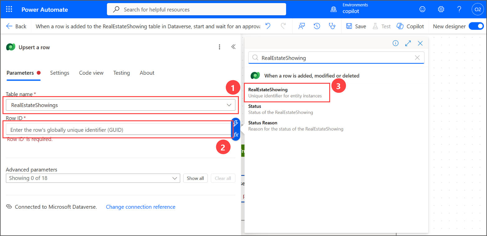

1. Open the **Advanced parameters (1)** list, and then select **Is Confirmed (2)**. Press **Esc** to close the list.

   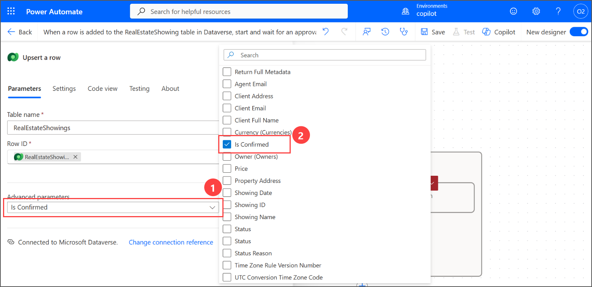

1. In **Is Confirmed**, select **Yes**.

   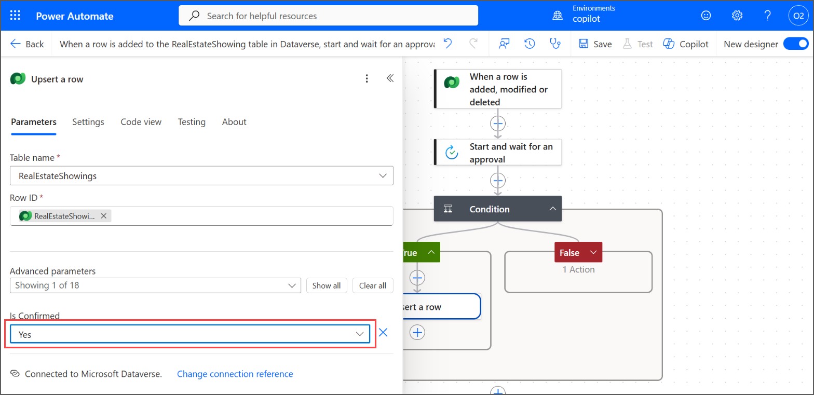

1. Under **False**, select **Upsert a row 2 (1)**. Repeat the previous three steps, but in **Is Confirmed**, select **No (2)**.

   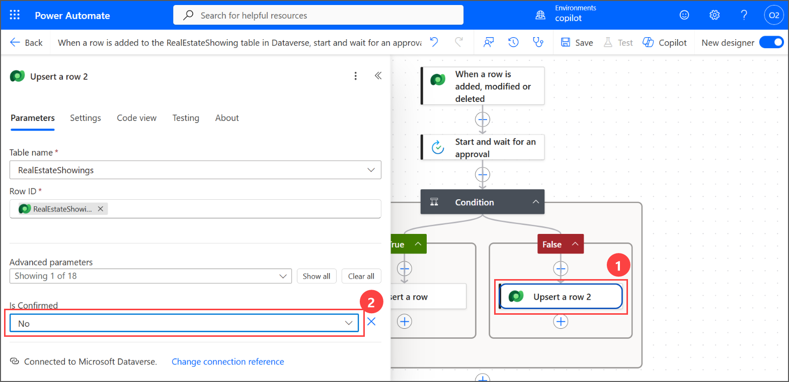

### Task 2: Add email notifications and test the flow

In this task, you'll add an email to each branch of the condition, save and test the flow, and then submit and approve a showing request.

1. On the canvas, under the **True** branch, select the **+** icon below **Upsert a row**. In the **Add an action** pane, search for **Send an email (V2)**, and then under **Office 365 Outlook**, select **Send an email (V2)**.

   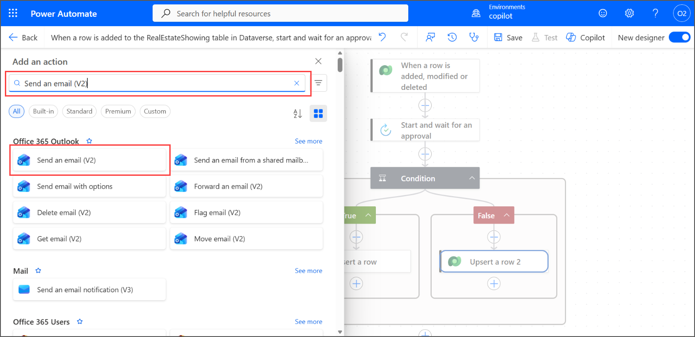

1. In the **Create connection** pane, enter **Office 365 Outlook** as the **Connection name (1)**, and then select **Sign in (2)**. If a **Pick an account** window opens, select your lab account.

   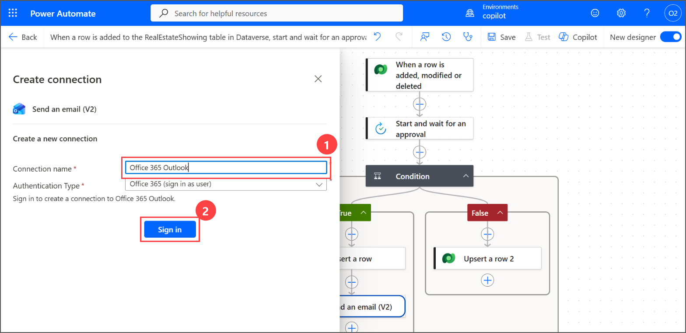

1. The **To** box searches people in your organization. To use a column value instead, select the **Settings** (gear) icon above **To**, and then select **Use dynamic content**.

   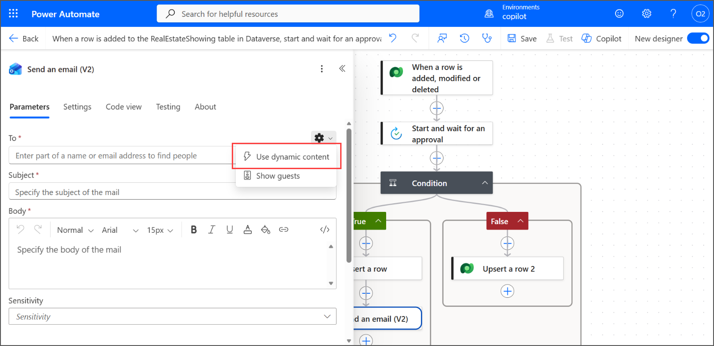

1. Select the **To** box, and then select the lightning icon **(1)**. Search for **Client Email**, and then under **When a row is added, modified or deleted**, select **Client Email (2)**.

   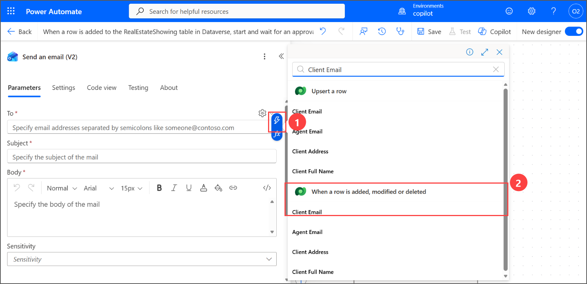

   > **Note:** The list also shows the columns returned by **Upsert a row**. Use the ones under the trigger in this lab.

1. In **Subject**, enter the following text:

   ```
   Your request for a real estate showing has been approved
   ```

1. In **Body (1)**, enter **Good day - Your request for a real estate showing has been approved. Please see below for details.**, and then add the following lines, each with the matching dynamic content from the trigger: **Property:** with **Property Address**, **Client:** with **Client Full Name**, and **Client Email:** with **Client Email**. On a new line, add **Response summary (2)** from the **Start and wait for an approval** action.

   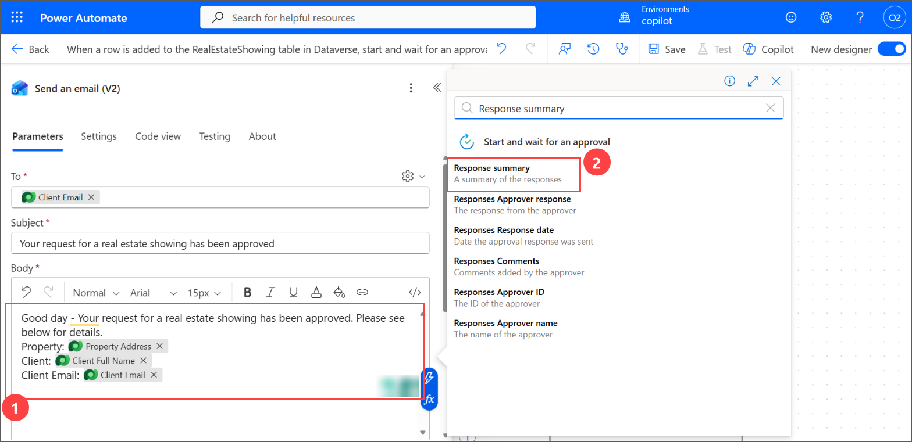

1. The completed action should resemble the following image.

   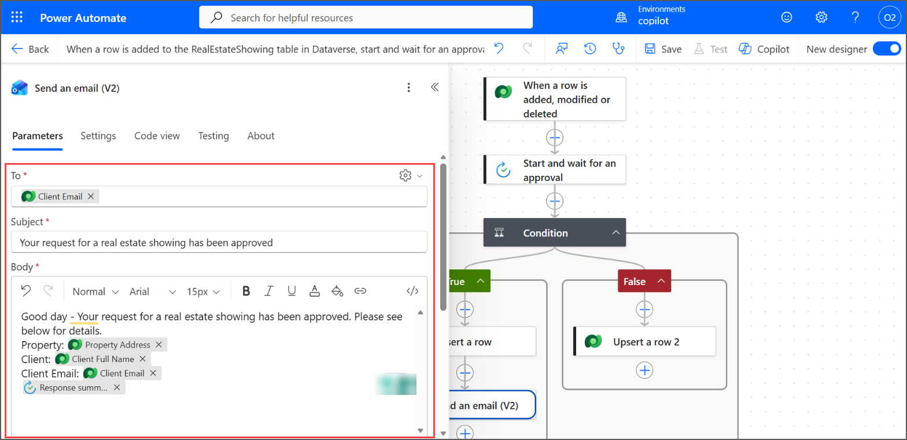

1. Under the **False** branch, select the **+** icon below **Upsert a row 2**, and add another **Send an email (V2)** action. In the **Change connection** pane, select the **Office 365 Outlook** connection that you created.

   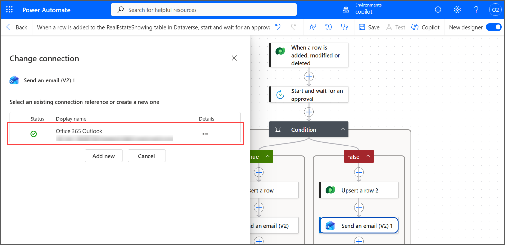

1. Configure **Send an email (V2) 1** in the same way as the first email, but use the following **Subject** and first line of the **Body**:

   - **Subject:** Your request for a real estate showing has been rejected
   - **Body:** Good day - Your request for a real estate showing has been rejected. Please see below for details.

     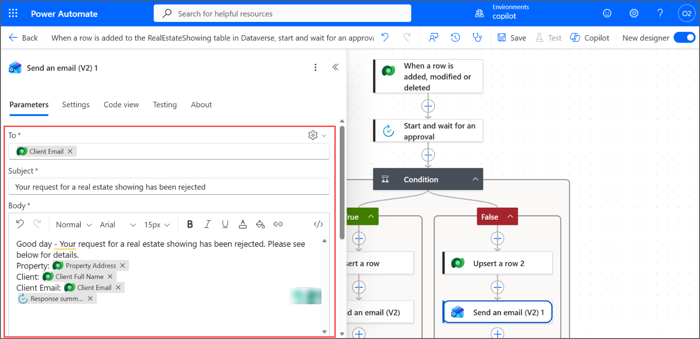

1. Select the flow name in the upper-left corner, and rename the flow to **Request Approval for Real Estate Showing**.

   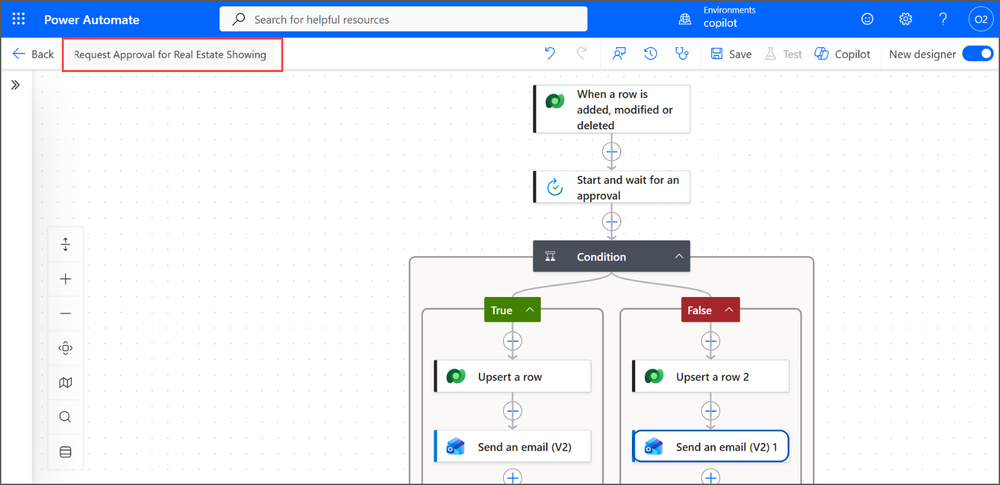

1. Select **Save**. When the flow is saved, the message **Your flow is ready to go. We recommend you test it.** appears.

   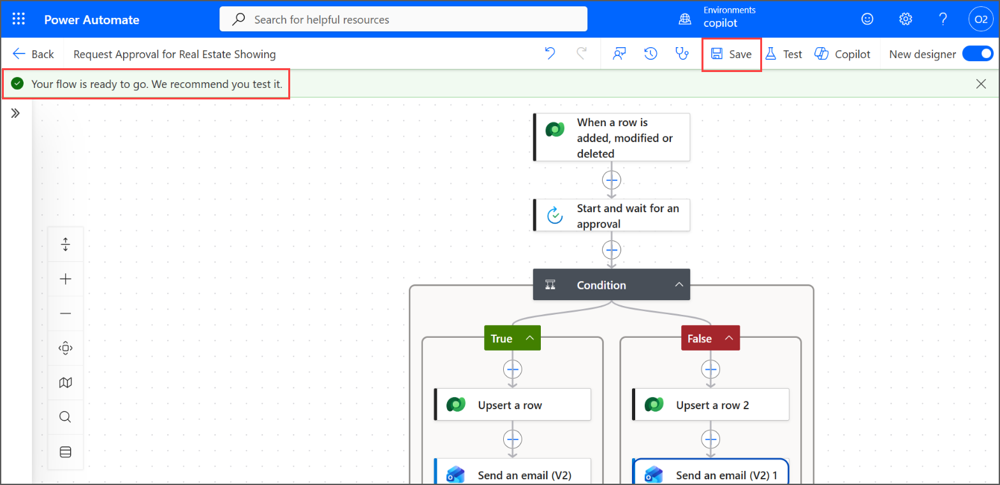

1. Select **Test**. In the **Test Flow** pane, select **Manually (1)**, and then select **Test (2)**.

   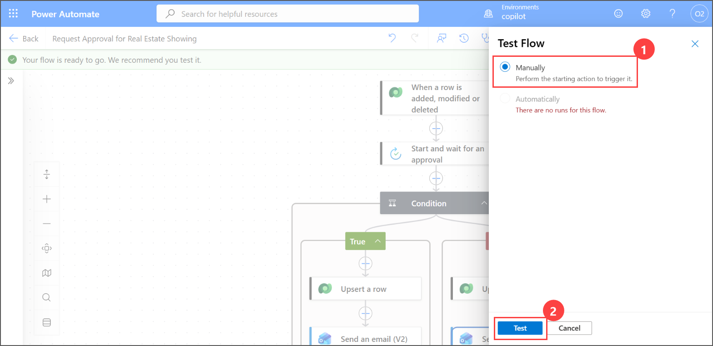

1. The flow waits for the trigger and shows **To see it work now, perform the starting action.** Leave this tab open.

   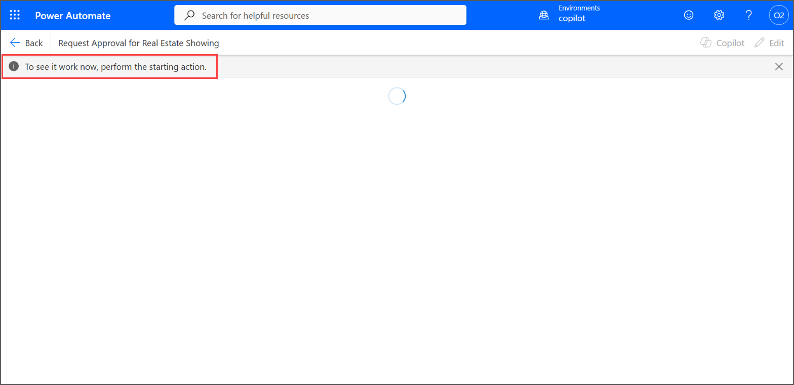

1. Open a new browser tab and navigate to Power Apps by copying and pasting the following link. Make sure the **Copilot** environment is selected, and then select **Apps**.

   ```
   https://make.powerapps.com
   ```

1. Next to **Real Estate Showings**, select **More commands (...) (1)**, and then select **Play (2)**. The app opens in a new tab. If a **Pick an account** page appears, select your lab account.

   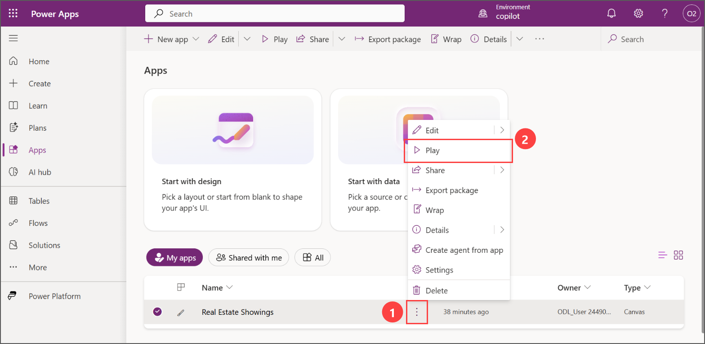

1. In the app, select **+ New** and enter the following values:

   - **Agent Email:** agent12@example.com
   - **Client Address:** 210 Pine Road, Portland, OR 97204
   - **Client Email:** <inject key="AzureAdUserEmail" enableCopy="true"/>
   - **Client Full Name:** Jordan Lee
   - **Price:** 610000
   - **Property Address:** 789 Chestnut Street, Portland, OR 97209
   - **Showing Date:** Any future date and time
   - **Showing Name:** Show L
   - **Status:** Scheduled

   Leave **Is Confirmed** empty, because the flow sets it. When you're done **(1)**, select the check mark **(2)** to save the record.

   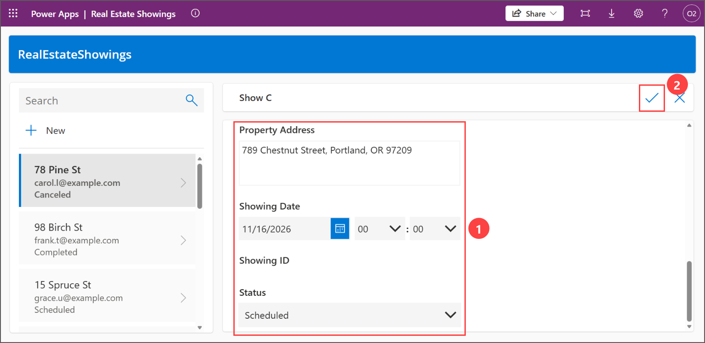

   > **Note:** You use your own lab email as the **Client Email** so that the result email arrives in your inbox.

1. Switch to the Power Automate tab. The flow is running and waits at **Start and wait for an approval**.

   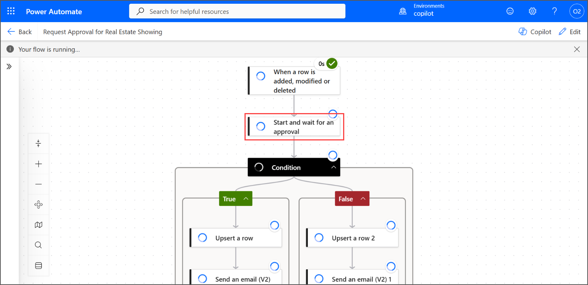

1. Open a new browser tab and navigate to Outlook by copying and pasting the following link. If a **Pick an account** page appears, select your lab account.

   ```
   https://outlook.office.com
   ```

   > **Note:** If a **Your privacy matters** message appears, select **Continue**.

1. Open the **New Request for Real Estate Showing** email from **Microsoft Power Automate (1)**, review the details, and then select **Approve (2)**.

   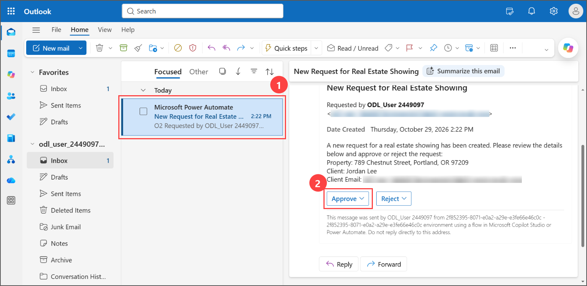

1. Enter a comment **(1)**, for example **Approved. The agent will confirm the time with the client.**, and then select **Submit (2)**.

   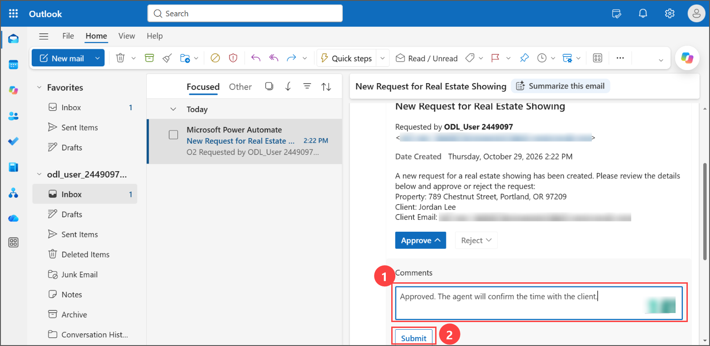

1. The email updates to **Approved (1)**, and within a minute the flow sends the **Your request for a real estate showing has been approved** email **(2)**.

   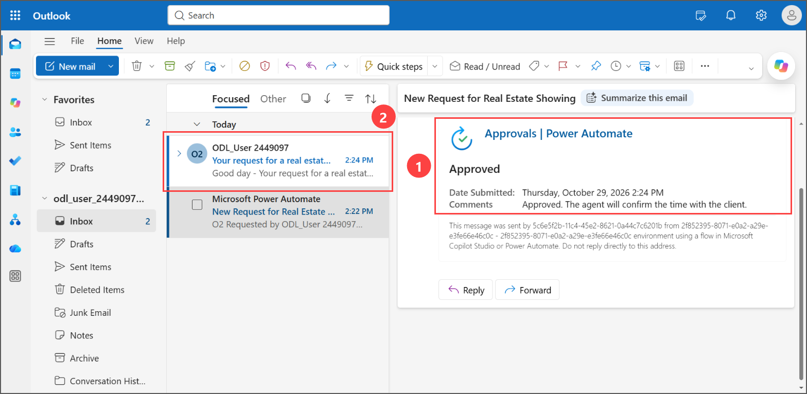

1. Open the new email. It contains the property, client, and client email from the record, and the approval response summary.

   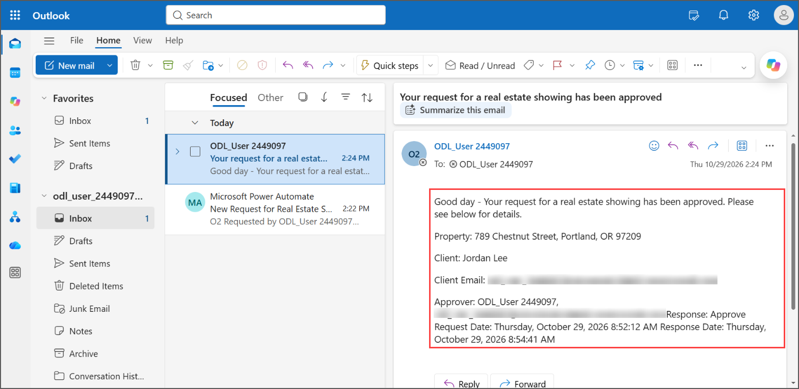

1. Switch to the Power Automate tab. The message **Your flow ran successfully.** appears, and the **True** branch actions show green check marks.

   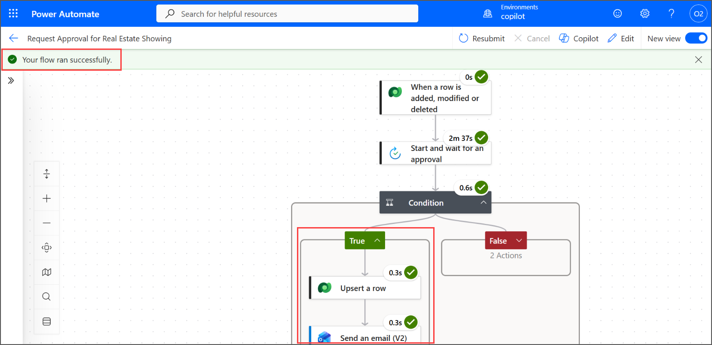

1. Select **Back**. If the **Your flow is ready to go** dialog appears, select **Got it**. In **28-day run history**, confirm that the run shows **Succeeded**.

   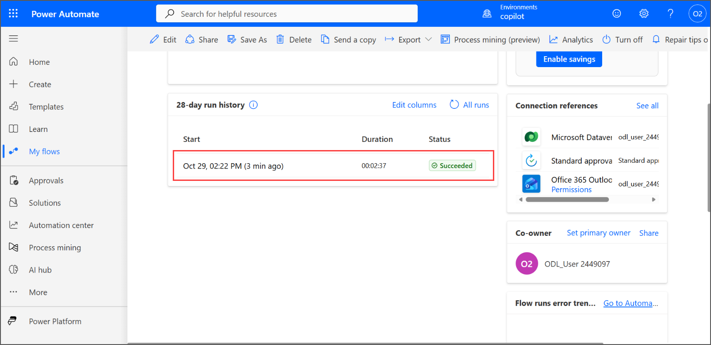

1. Switch to the Real Estate Showings app tab and refresh the page. Select the **Show L** record and confirm that **Is Confirmed** is now **True**, which the flow set after the approval.

   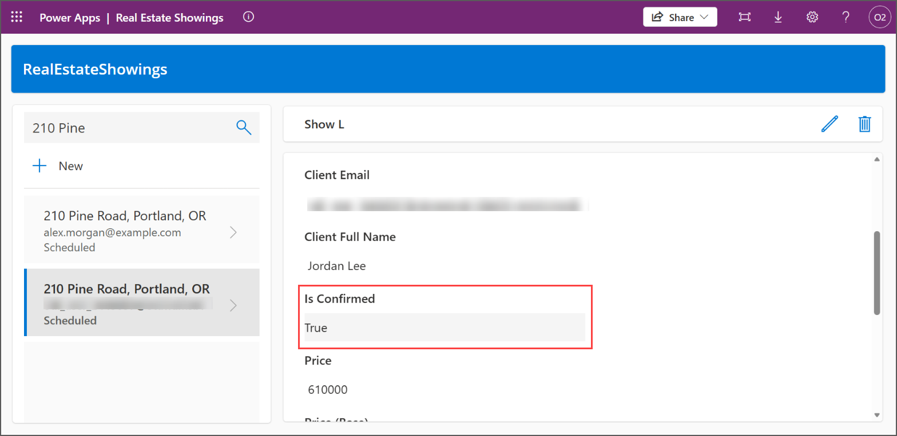

## Summary

In this lab, you have accomplished the following:

- Described an approval flow to Copilot in Power Automate and completed the trigger, approval, condition, and update actions it generated.
- Added email notifications for approved and rejected requests and tested the flow from the Real Estate Showings app.
- Approved a request in Outlook and confirmed that the flow updated the record and notified the client.

### Congratulations! You have successfully completed this lab. Click **Next** to continue to the next lab.
