# Module 5: Share a cloud flow

## Lab scenario

In this exercise, you'll create a cloud flow inside a solution and then share it in the two ways Power Automate offers. The flow flags every new email that arrives in your Inbox, so that showing requests stand out. You'll test the flow, add a co-owner who gets full control of the flow, and send a copy that other people can use to create their own instance of the flow. This lab shows how to manage and share cloud flows to support teamwork.

## Lab objectives

In this lab, you will complete the following tasks:

- Task 1: Create and test a cloud flow
- Task 2: Add an owner to a cloud flow
- Task 3: Send a copy of a cloud flow

### Task 1: Create and test a cloud flow

In this task, you'll create a solution, add an automated cloud flow to it that flags new emails, and test the flow.

1. Open a new browser tab and navigate to Power Automate by copying and pasting the following link:

   ```
   https://make.powerautomate.com
   ```

   > **Note:** If you're asked to sign in, use the following credentials. If a **Pick an account** page appears, select your lab account.
   >
   > - **Email/Username:** <inject key="AzureAdUserEmail" enableCopy="true"/>
   > - **Temporary Access Pass:** <inject key="AzureAdUserPassword" enableCopy="true"/>

1. Make sure the **Copilot (1)** environment is selected in the upper-right corner. If it isn't, select **Environments** and then select **Copilot**. In the left navigation, select **Solutions (2)**.

   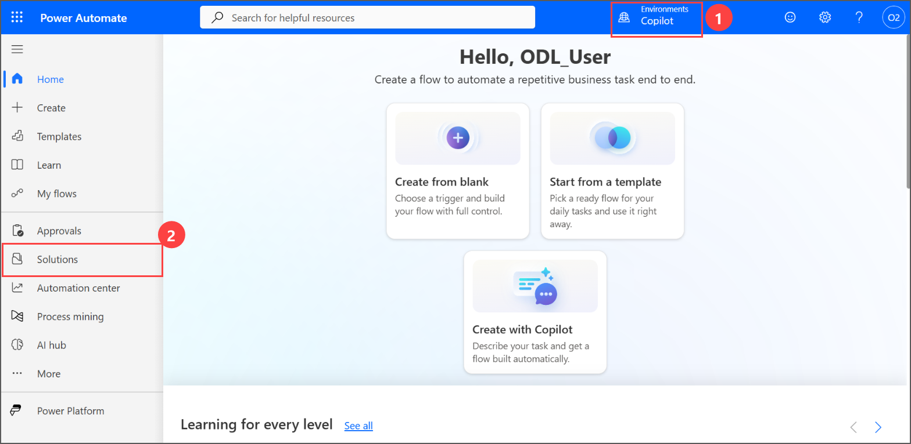

   > **Hint:** If the left navigation shows only icons, select the **Navigation menu** (three lines) icon at the top to show the labels.

1. On the **Solutions** page, select **+ New solution**.

   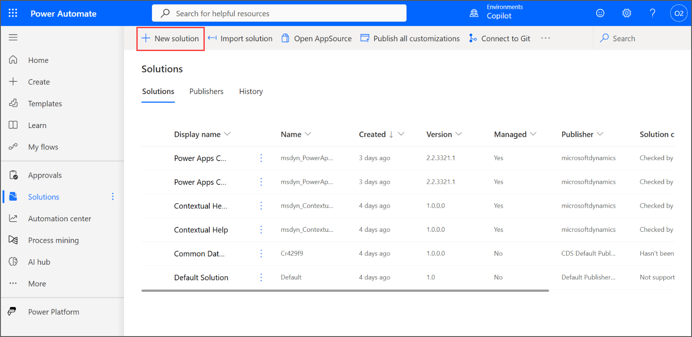

1. In the **New solution** pane, enter **Copilot** as the **Display name (1)**. The **Name** fills in automatically. In **Publisher**, select **Default Publisher for org... (2)**, and then select **Create (3)**.

   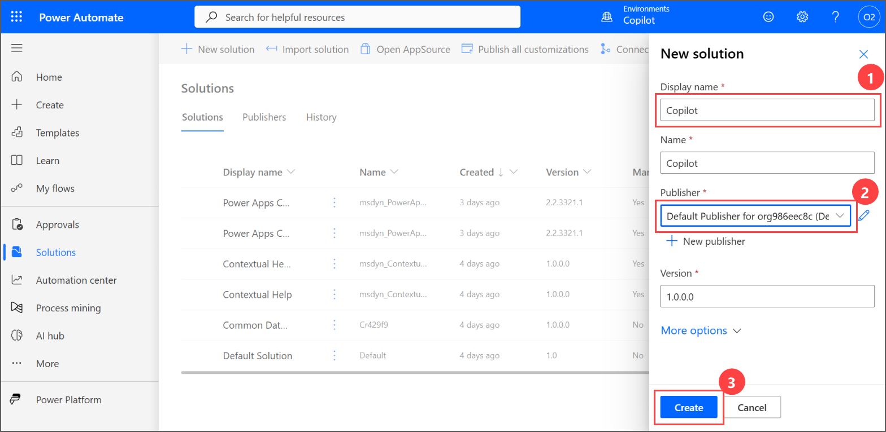

1. The **Copilot** solution opens. Select **+ New**, point to **Automation**, point to **Cloud flow**, and then select **Automated**.

   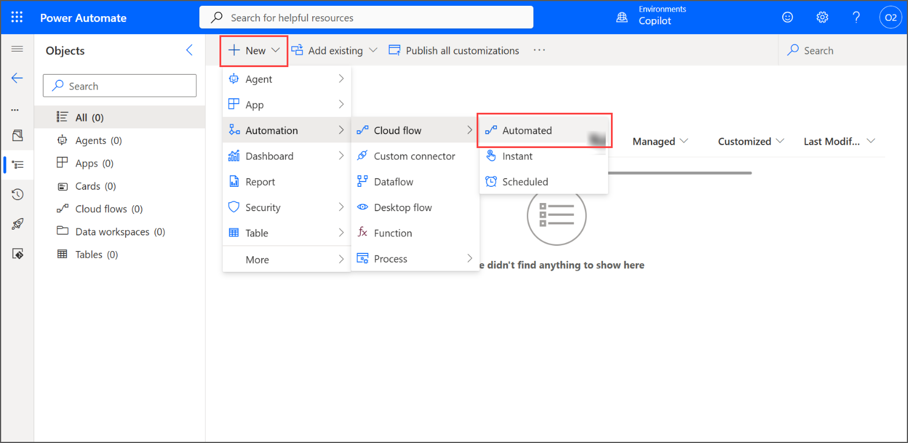

1. In the **Build an automated cloud flow** dialog, enter **my child flow** as the **Flow name (1)**. In **Choose your flow's trigger**, search for **new email**, select **When a new email arrives (V3) (2)** from **Office 365 Outlook**, and then select **Create (3)**.

   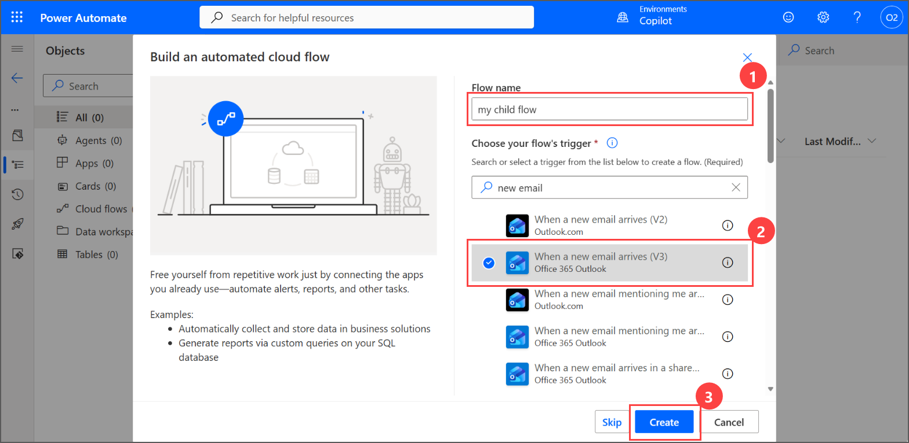

1. The flow designer opens with the trigger. Select **+ New step**.

   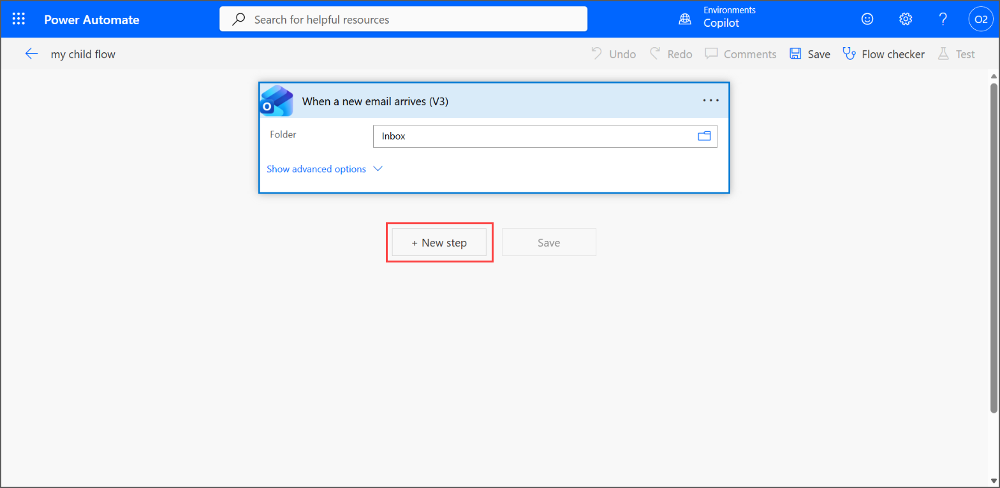

   > **Note:** Flows that you create from a solution open in the classic designer, which this lab uses. If the new designer opens instead, turn off the **New designer** toggle in the upper-right corner.

1. In the **Choose an operation** box, search for **Flag email (1)**, and then select **Flag email (V2) (2)** from **Office 365 Outlook**.

   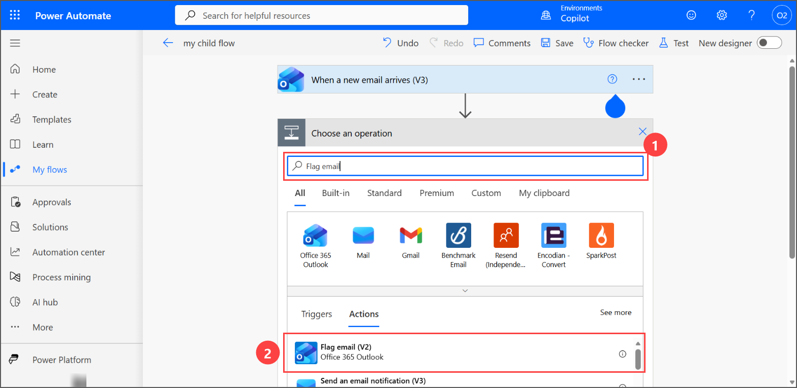

   > **Note:** Earlier versions of this lab used **Send me a mobile notification**. That action no longer works because the Power Automate mobile app was retired. If the action list doesn't load, change the search text and try again.

1. Select the **Message Id** box. In the dynamic content list, under **When a new email arrives (V3)**, select **Message Id**. Leave **Flag Status** set to **Flagged**.

   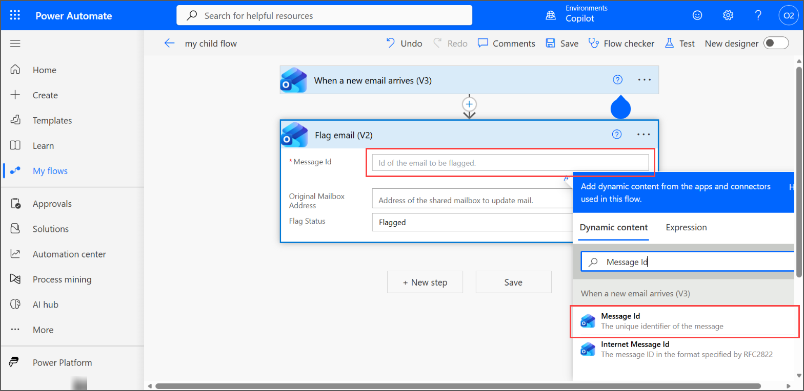

1. The **Flag email (V2)** action should resemble the following image **(1)**. Select **Save (2)**. When the flow is saved, the message **Your flow is ready to go. We recommend you test it.** appears.

   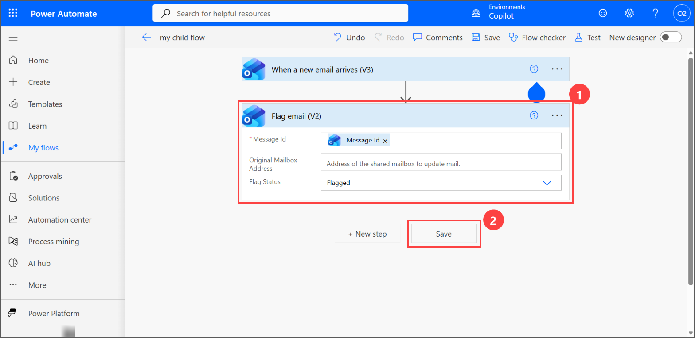

1. Select the **back arrow** in the upper-left corner to return to the solution. **my child flow** is listed in the **Copilot** solution.

   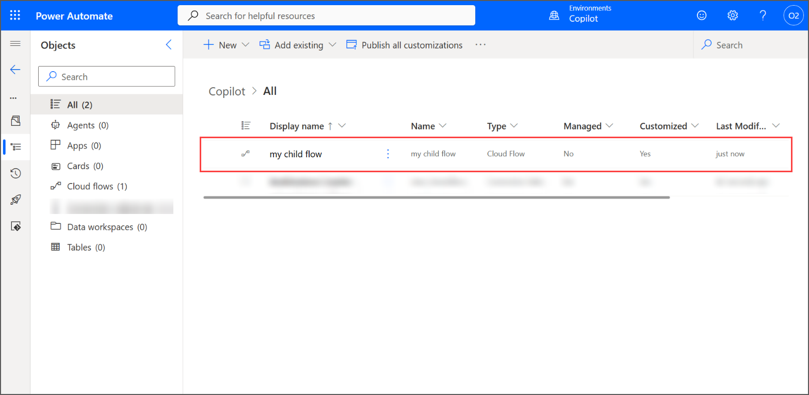

1. To test the flow, open a new browser tab and navigate to Outlook by copying and pasting the following link. Select **New mail**, enter your lab email in **To**, enter **Showing request for 210 Pine Road** as the **Subject**, and then select **Send**.

   ```
   https://outlook.office.com
   ```

   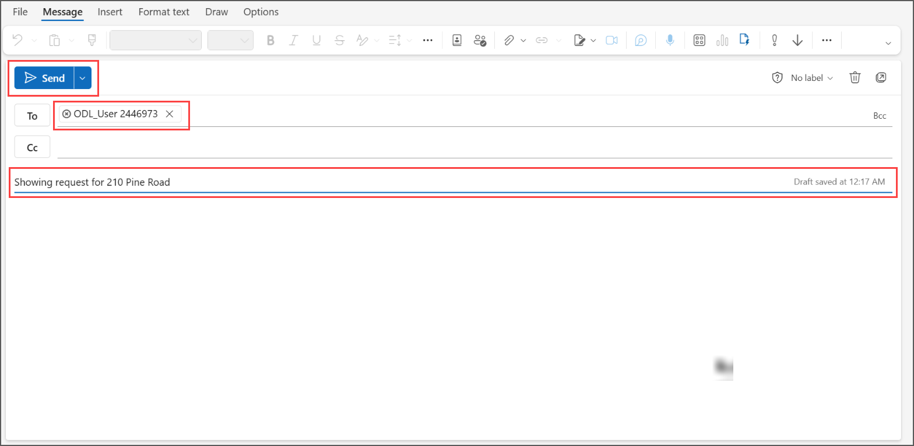

   > **Note:** If a **Your privacy matters** message appears, select **Continue**.

1. Wait a few minutes, and then return to the Power Automate tab. Select **My flows**, select **my child flow**, and in **28-day run history**, confirm that the run shows **Succeeded**.

   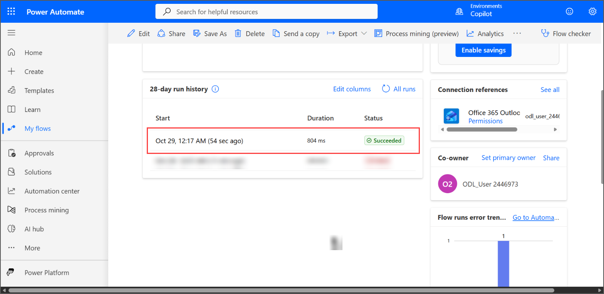

   > **Note:** The trigger checks the mailbox every few minutes, so the run can take up to five minutes to appear. Select **All runs** to refresh the list.

### Task 2: Add an owner to a cloud flow

In this task, you'll add a co-owner to the flow. A co-owner has full control of the flow: they can edit it, see its run history, and add or remove other owners.

1. In the left navigation, select **My flows (1)**. Point to **my child flow**, and then select the **Share (2)** icon.

   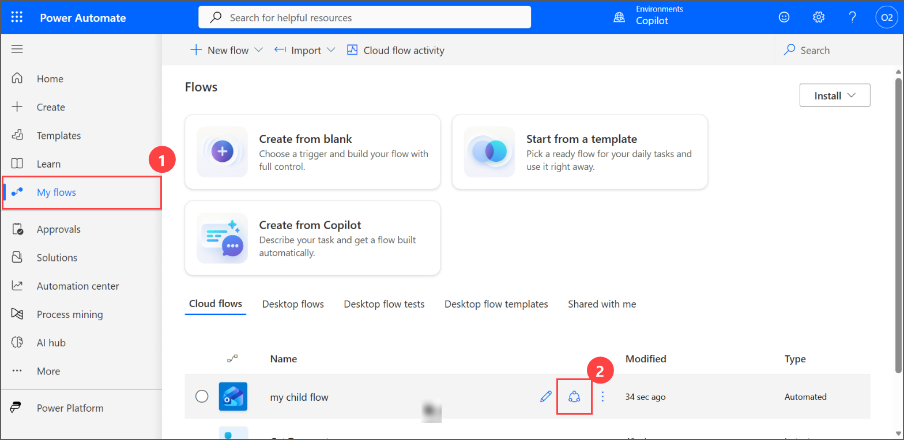

1. On the **Co-owners** page, in **Add a system user or team as an owner**, enter **odl_user**, and then select your lab account from the list.

   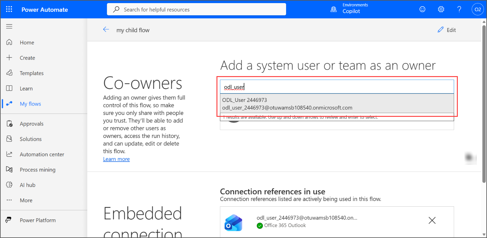

   > **Note:** In a real project you add a colleague or a team here. Your lab tenant has no other lab users, so you add your own account as the owner record.

1. The **Before you share** dialog lists the connections that co-owners can use through this flow. Review it, and then select **OK**.

   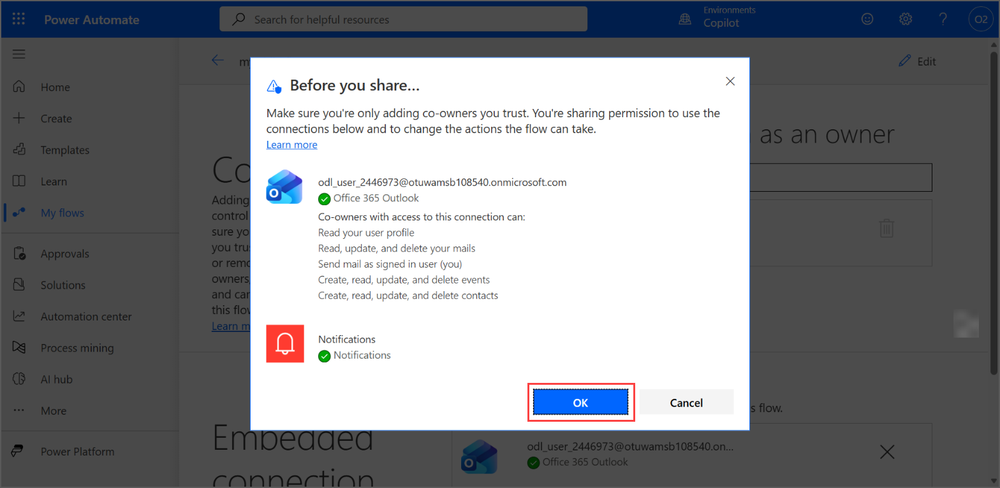

1. The user is added to the list of owners and becomes an owner of the flow.

   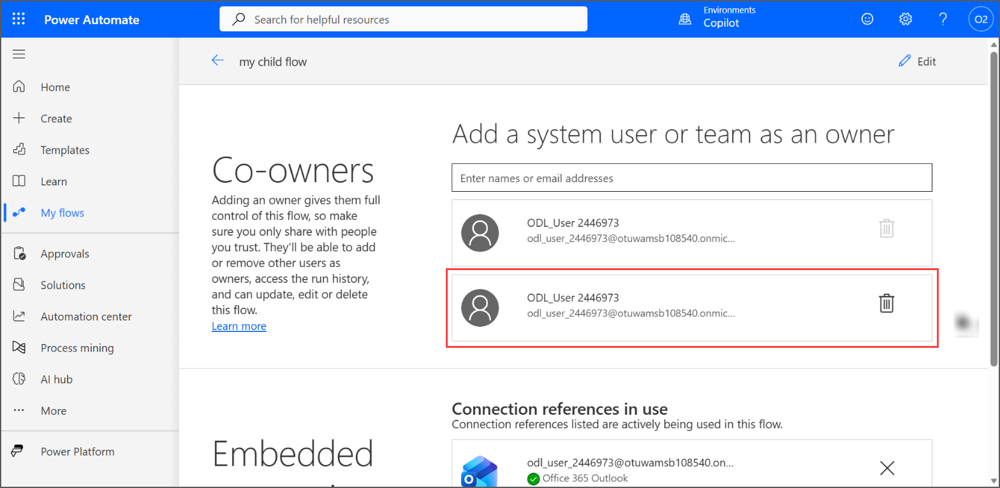

### Task 3: Send a copy of a cloud flow

In this task, you'll send a copy of the flow. Recipients get their own copy that they can change and run on their own, separate from your flow.

1. Select the **back arrow** to open the flow details page, and then select **Send a copy** on the toolbar.

   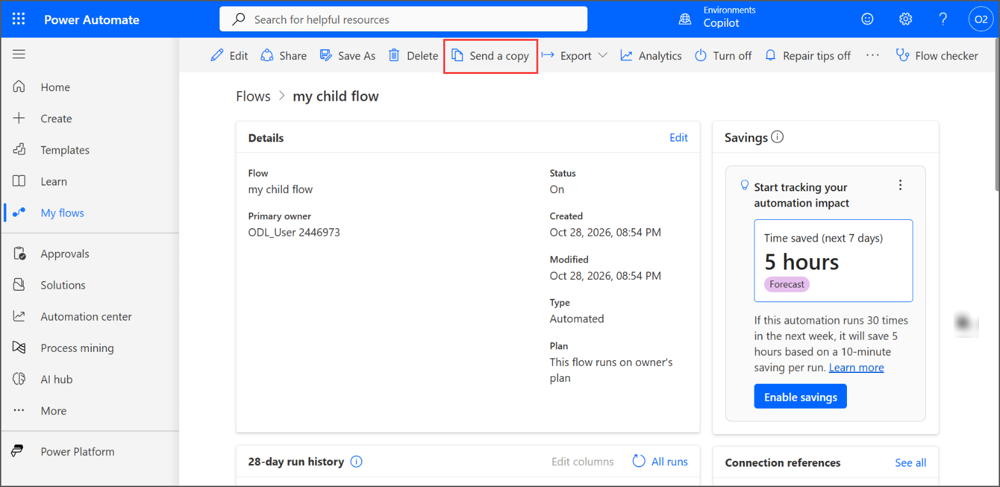

   > **Note:** If the panel shows **Flow has been modified since last successful run.** and the fields are disabled, run the flow first, as in the last steps of Task 1.

1. In the **Send a copy** panel, keep the **Title**, and enter **Flags each new email in the Inbox so it stands out.** as the **Description**. In **Send to**, enter **odl_user**, select your lab account, and then select **Send**.

   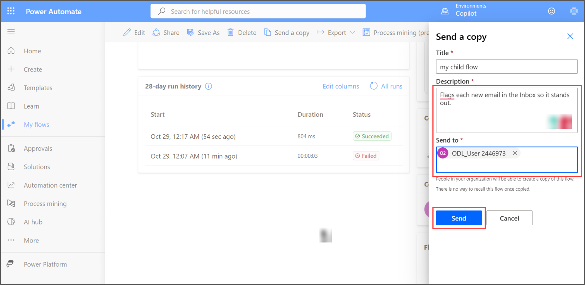

1. The message **Flow successfully sent as a copy. Recipients will now be able to create their own instances of this flow.** appears. Close the panel.

   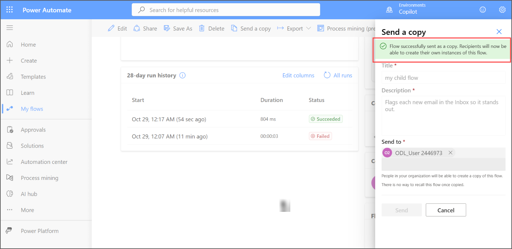

1. Switch to the Outlook tab. An email from **Microsoft Power Automate** says that the flow has been shared with you. Your flow has also flagged it, because it's a new email in your Inbox.

   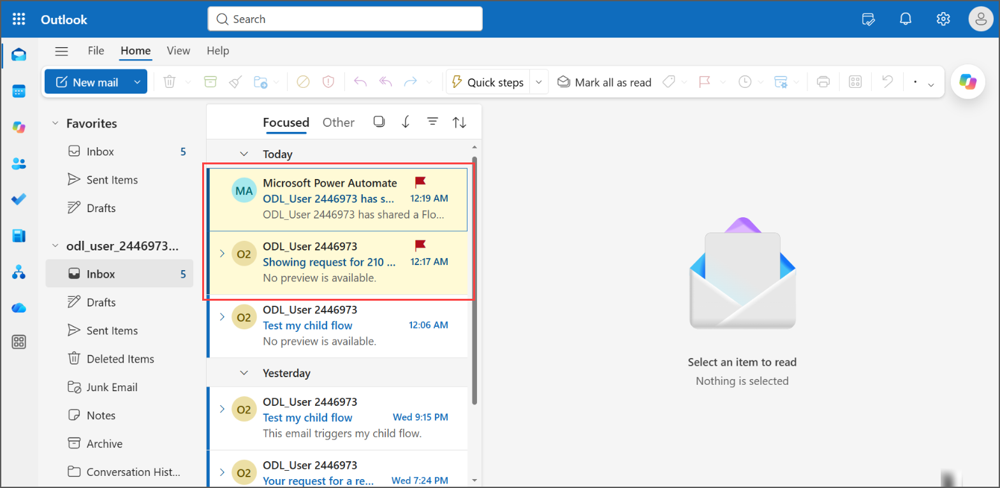

   > **Note:** The recipient can open the shared flow from this email and create their own copy of it.

## Summary

In this lab, you have accomplished the following:

- Created a solution and an automated cloud flow that flags new emails, and tested it.
- Added an owner to the cloud flow, which gives full control of the flow.
- Sent a copy of the cloud flow, so that recipients can create their own instance of it.

### Congratulations! You have successfully completed the lab.
